# Reason-Graph

### Probabilistic hallucination detection for LLM answers — a reproduction of BTProp, extended to answer-level graphs with loopy belief propagation and to cheaper confidence scoring

> Course project · 22AIE301 Probabilistic Reasoning · Open-source models only, no paid APIs
>
> Base paper: B. Hou, Y. Zhang, J. Andreas, S. Chang. *A Probabilistic Framework for LLM
> Hallucination Detection via Belief Tree Propagation.* NAACL 2025.

---

## Contents

1. [Abstract](#1-abstract)
2. [Background: the problem and the base paper](#2-background-the-problem-and-the-base-paper)
3. [System architecture](#3-system-architecture)
4. [Method](#4-method)
   - 4.1 [Confidence from the LLM](#41-confidence-from-the-llm)
   - 4.2 [Building a belief tree](#42-building-a-belief-tree)
   - 4.3 [Relationships with NLI](#43-relationships-with-nli)
   - 4.4 [The Hidden Markov Tree](#44-the-hidden-markov-tree)
   - 4.5 [Calibration (emission model)](#45-calibration-emission-model)
   - 4.6 [Extension 1: one graph per answer, loopy belief propagation](#46-extension-1-one-graph-per-answer-loopy-belief-propagation)
   - 4.7 [Extension 2: surrogate confidence scorer](#47-extension-2-surrogate-confidence-scorer)
5. [Experimental setup](#5-experimental-setup)
6. [Results](#6-results)
7. [Discussion](#7-discussion)
8. [Limitations](#8-limitations)
9. [Reproducing everything](#9-reproducing-everything)
10. [Demo and API](#10-demo-and-api)
11. [Repository guide](#11-repository-guide)
12. [Engineering and verification](#12-engineering-and-verification)
13. [Design decisions](#13-design-decisions)
14. [References and credits](#14-references-and-credits)

---

## 1. Abstract

Large language models state false facts fluently, and their own confidence is a weak signal of
when they do. BTProp (Hou et al., 2025) improves on a single confidence query by expanding each
statement into a **belief tree** of related statements — decompositions, supporting premises
and corrections — labelling how they depend on each other with a natural-language-inference
(NLI) model, and combining all the LLM's confidences in a **Hidden Markov Tree** whose exact
belief propagation yields P(statement is true).

We **reimplement BTProp from scratch** with open models only (Llama-3-8B-Instruct on free
Kaggle GPUs, DeBERTa-v3 NLI) and evaluate on **FELM-Science** with a strict fit/test split.
We then make two contributions:

1. **Answer-level graphs.** The paper checks every sentence of an answer in isolation. We join
   the trees of all sentences of one answer, link sentences that the NLI model finds related,
   and run **loopy belief propagation** on the resulting factor graph, which has cycles.
2. **A surrogate confidence scorer.** A tiny model (hashed words + ridge regression) learns to
   predict the LLM's confidence from text, replacing a chosen share of LLM confidence calls —
   the cost the paper's authors name as their main limitation.

On 304 held-out sentences (49 false), our answer graph reaches **AUROC 0.773 and AUC-PR 0.475**,
against 0.745 / 0.329 for the LLM's raw confidence and 0.741 / 0.403 for our BTProp
reproduction. Loopy BP converged on all 122 graphs. The surrogate replaces **63% of confidence
calls with no loss in AUROC**. With only 49 false test sentences, one gain clears a 95% cluster
bootstrap (graph vs. raw, AUC-PR) and the others are consistent but not yet significant; we
report all of them.

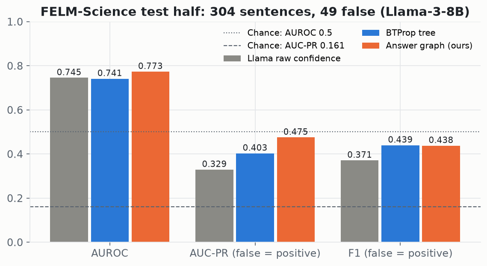

---

## 2. Background: the problem and the base paper

**Task.** Given an LLM-written answer split into sentences, score each sentence with P(true) so
that false sentences ("hallucinations") come out lowest. Evaluated with AUROC, AUC-PR and F1,
with a *false* sentence as the positive class.

**Why a single confidence is not enough.** Asked "is this true?", an LLM is often confidently
wrong. On our fit half, 156 of 179 sentences in Llama's most-confident bucket are true — but so
are 23 false ones (Section 6.1).

**BTProp's idea.** Ask more questions *around* the statement and let probability theory
combine the answers:

```
                 "The Eiffel Tower, built in 1889, is in Berlin."        P(True) = 0.31
                    /                    |                    \
     decomposition  /       decomposition|          correction \
  "It was built in 1889."    "It is in Berlin."     "…is in Paris."   (contradicts the root)
      P(True) = 0.97          P(True) = 0.04         fixed evidence
```

Each node's LLM confidence is *noisy evidence* about a hidden truth; the edges say how truths
constrain each other ("parent true only if every claim is true", "the correction contradicts
the parent"). Belief propagation over the tree turns all of it into one posterior for the root.
(Numbers in this sketch are illustrative.)

**What the paper leaves open, and we address.**

| Limitation named in / implied by the paper | Our answer |
|---|---|
| Tree only: a statement has exactly one parent; sentences of one answer are checked independently | Answer-level factor graph with cycles + loopy BP (§4.6) |
| Many LLM calls per tree; cost grows with depth | Surrogate confidence scorer (§4.7) |
| Evaluated on a hand-cleaned dataset that is not public | Automatic stand-alone rewriting with an NLI faithfulness check (§5.2) |

---

## 3. System architecture

### 3.1 End-to-end pipeline

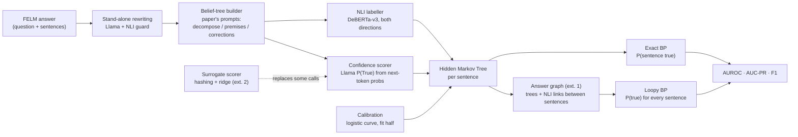

### 3.2 Code modules

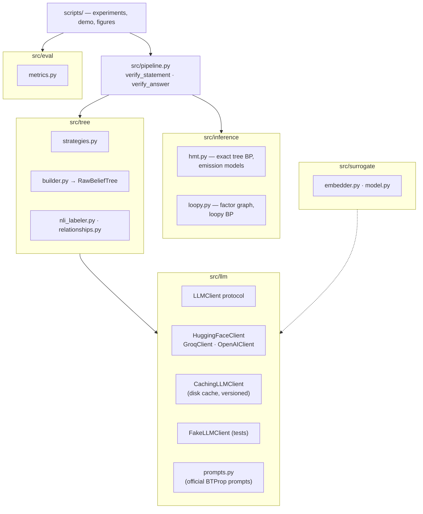

`src/inference` never imports `src/llm`: the probability code consumes plain numbers, so it is
tested against hand-computed values with no model, network or key.

### 3.3 Where each number comes from

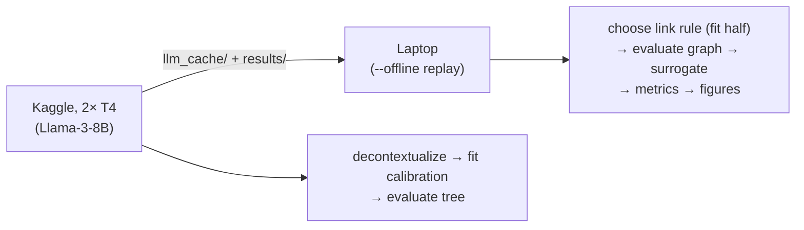

Every LLM answer is cached on disk, so all later steps replay Llama's answers exactly without
re-running it.

---

## 4. Method

### 4.1 Confidence from the LLM

For a statement *s*, Llama-3-8B-Instruct is given the official BTProp three-turn chat (an
instruction to judge True/False, the assistant's acknowledgement, then `Statement: s`). We read
the next-token distribution and define

$$S(s) = \frac{P(\texttt{True})}{P(\texttt{True}) + P(\texttt{False})}$$

summing over the tokenizer's spellings of each word. This is the paper's confidence method; it
needs the model's probabilities, which hosted APIs such as Groq do not expose (they were used
only for development, D6).

### 4.2 Building a belief tree

Following the official code exactly (D29):

1. **Decomposition.** The LLM lists the statement's check-worthy claims (`Claim 1: …`). More
   than one claim → the claims become the children. "No check-worthy claims" → the root stays
   a leaf.
2. Otherwise the LLM **chooses a strategy**: *Logical Relation* → premises, *Statement
   Perturbation* → corrections, or both.
3. **Supporting premises.** Two samples at temperature 0.7; at most 3 premises kept.
4. **Corrections.** The LLM writes a question whose answer is the statement's key fact, samples
   5 answers, and rewrites the statement with each (`Revised Answer: …`); at most 5 kept, copies
   of the parent skipped. Corrections are leaves with a fixed observation (§4.5).
5. Every child is NLI-labelled against its parent; *neutral* (unrelated) children are dropped.

Depth is 1 (the paper uses 2) to fit free GPU time (D16). On the test half, trees have 1–9
nodes (mean 3.4); 50 of 304 sentences got no children.

### 4.3 Relationships with NLI

`cross-encoder/nli-deberta-v3-large` (the paper's checkpoint) is run in both directions,
child→parent and parent→child, and combined:

| Forward (child ⇒ parent) | Backward (parent ⇒ child) | Relationship |
|---|---|---|
| entailment | entailment | EQUIVALENCE |
| entailment | not entailment | ENTAILMENT (child ⇒ parent) |
| not entailment | entailment | REVERSE_ENTAILMENT (parent ⇒ child) |
| contradiction in either direction | | CONTRADICTION |
| otherwise | | NEUTRAL (dropped) |

### 4.4 The Hidden Markov Tree

Every node *u* has a hidden truth value $Z_u \in \{T, F\}$ and an observed confidence $S_u$.

- **Emission** $p(S_u \mid Z_u)$ — how reliable a confidence is (§4.5).
- **Transitions** $p(Z_{\text{children}} \mid Z_{\text{parent}})$:
  - *Decomposition* (joint over all claims): parent true ⇒ every claim true; parent false ⇒
    uniform over the $2^k - 1$ configurations that are not all-true.
  - *Premises / corrections* (each child independent given the parent), the official values:

    | Relationship | P(child T \| parent T) | P(child T \| parent F) |
    |---|---|---|
    | Equivalence | 1.0 | 0.0 |
    | Entailment (child ⇒ parent) | 0.5 | 0.0 |
    | Reverse entailment (parent ⇒ child) | 1.0 | 0.5 |
    | Contradiction | 0.0 | 0.5 |

**Inference** is exact on a tree. The upward message is

$$\beta_u(z) = p(S_u \mid Z_u = z)\sum_{\mathbf{z}_c} p(\mathbf{Z}_c = \mathbf{z}_c \mid Z_u = z)\prod_{c} \beta_c(z_c)$$

and the posterior is $P(Z_r = T \mid S) \propto \pi(T)\,\beta_r(T)$ with prior $\pi = 0.5$.
Because each parent may need a different rule, one `DispatchingTransition` looks the rule up
from the `parent_id` argument on every call — no state carried between calls (§12).

### 4.5 Calibration (emission model)

We fit two emission models on the **fit half only**:

- **5-bucket table** (the paper's): edges 0.19 / 0.39 / 0.69 / 0.89; $p(\text{bucket} \mid Z)$
  by counting.
- **Logistic curve** (Platt scaling, D27): $P(Z = T \mid S) = \sigma(a \cdot \text{logit}(S) +
  b)$, converted to an emission by Bayes: $p(S \mid Z{=}T) \propto P(T \mid S)/P(T)$. It cannot
  reverse the order of two confidences, which the sparse table did on our data.

Fitted on 291 sentences: $a = 0.160$, $b = 1.160$, base rate 0.818.
Corrections carry their own fixed evidence, $p(\text{obs} \mid T) = 0.8$, $p(\text{obs} \mid F) =
0.2$, as in the official configuration.

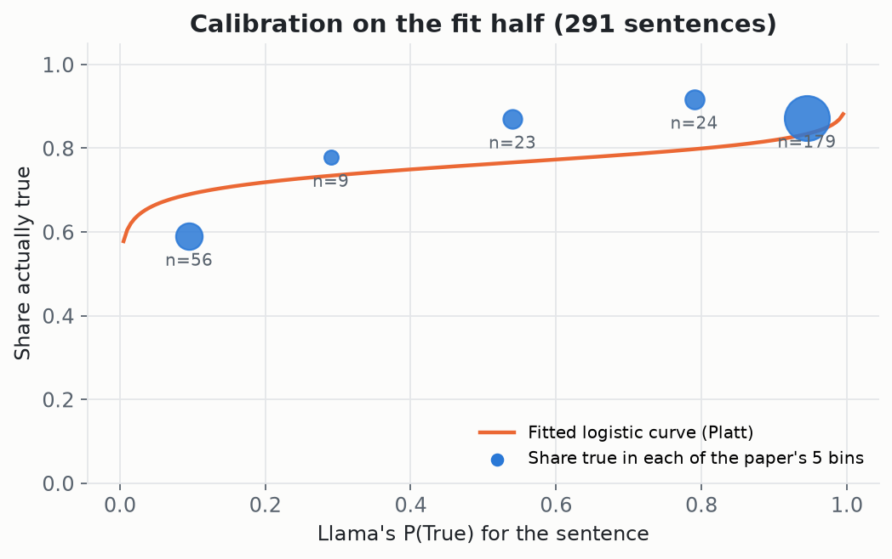

### 4.6 Extension 1: one graph per answer, loopy belief propagation

The sentences of one answer are about the same topic and often support each other. We build
**one factor graph per answer**:

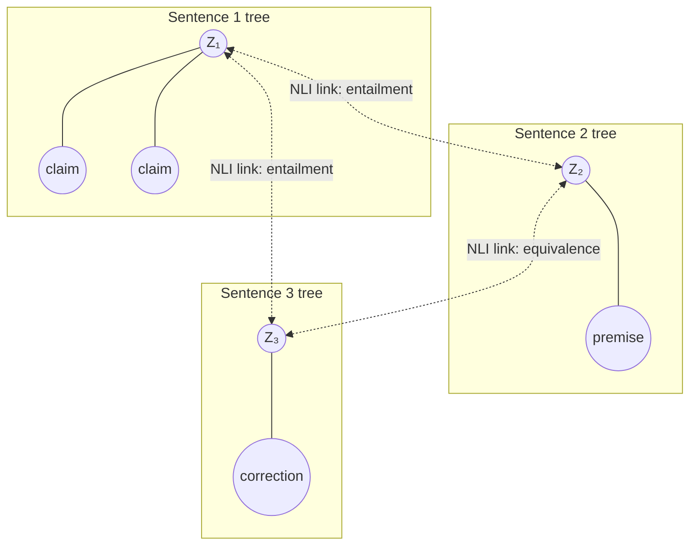

- **Factors.** Evidence factors $p(S_u \mid Z_u)$ (times the prior on each sentence root); one
  *joint* factor per parent over the parent and all its children (so the decomposition rule
  carries over exactly — a pairwise-only graph cannot express it, D32); and one pairwise
  factor per **cross link** between sentence roots, using the same relationship table as §4.4,
  softened into $[0.05, 0.95]$ so one NLI mistake makes two sentences unlikely together, never
  impossible.
- **Loops.** Three mutually linked sentences form a cycle, so exact tree recursion no longer
  applies. We run **sum-product loopy BP** with synchronous ("flooding") updates, damping 0.5,
  tolerance $10^{-6}$ on the largest message change, at most 200 rounds. Convergence is
  recorded per graph, never assumed.

$$m_{f \to v}(z_v) \propto \sum_{\mathbf{z}_f \setminus z_v} f(\mathbf{z}_f)\prod_{w \in f \setminus v} m_{w \to f}(z_w),
\qquad m_{v \to f}(z_v) \propto \prod_{g \ni v,\, g \neq f} m_{g \to v}(z_v)$$

- **Which links to keep (D35).** With every NLI label, 96 of 168 cross links were
  "contradiction" — mostly two different facts about one topic. Three rules were compared **on
  the fit half only** (one node per sentence, its Llama confidence, linked under the rule):

  | Rule | Meaning | Links | Fit-half AUROC |
  |---|---|---|---|
  | none | no links (independent sentences) | 0 | 0.724 |
  | any | the paper's labeller | 185 | 0.699 |
  | strict | contradiction only if both directions say so | 140 | 0.727 |
  | **no_contradiction** | drop contradiction links | 66 | **0.736** ← chosen |

  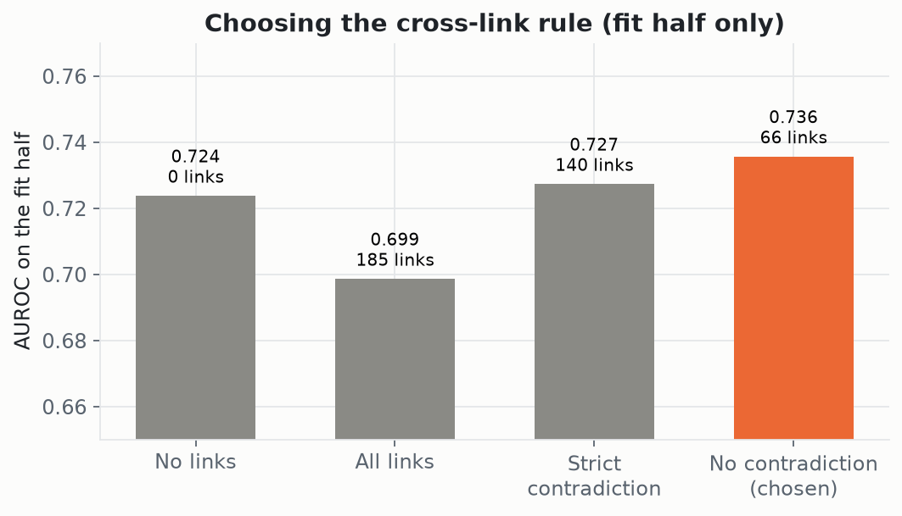

### 4.7 Extension 2: surrogate confidence scorer

- **Model.** Words and word pairs hashed into 4,096 slots (non-negative, L2-normalised; nothing
  downloaded or learned) → ridge regression ($\alpha = 1$) → clipped to $[0, 1]$. It predicts
  **Llama's confidence**, never the human labels.
- **No leakage.** Test answers are split into 5 groups; each group's nodes are predicted by a
  surrogate trained on the other 4 groups plus the fit-half sentences. A node is never predicted
  by a model that saw its answer.
- **Delegation curve.** 0/25/50/75/100% of the LLM-scored nodes get the surrogate's score instead
  (random choice, 5 repeats), under two schemes: any node, or child nodes only (the sentence keeps
  its real score). Corrections are excluded — they never cost a confidence call.

---

## 5. Experimental setup

### 5.1 Data: FELM-Science

FELM (`hkust-nlp/felm`, raw `all.jsonl`), science domain: ChatGPT answers to science questions,
split into segments, each labelled true/false by annotators.

| | Answers | Sentences | False |
|---|---|---|---|
| After cleaning (D19, D26: non-claims, duplicates, list openers removed) | 123 | 595 | 102 |
| **Fit half** — calibration, link rule, every choice | 62 | 291 | 53 |
| **Test half** — scored once, every variant reported | 61 | 304 | 49 |

The split is by **whole answer** (sentences of one answer share wording), stratified by whether
an answer contains an error, seed 42.

### 5.2 Stand-alone sentences (D30)

Many segments only make sense in context ("They are located on the wings"). The paper used a
hand-cleaned file that is not public. We have Llama rewrite each segment using its question and
full answer ("Ground spoilers are located on the wings"), told not to add or correct anything.
**A rewrite is kept only if the NLI model says it entails the original**, so it cannot drop the
very clause that made a sentence false. Labels never change.

| Segments | Rewritten | Rewrites rejected by the check |
|---|---|---|
| 594 | 385 | 122 (original kept) |

Examples — kept: *"No, WiFi generally has a longer range than Bluetooth."* → *"WiFi generally has
a longer range than Bluetooth."*; rejected correctly: *"Yes, there can be an explosion without
fire."* → a different sentence about causes of explosions; rejected too strictly: *"They code
for traits…"* → *"Genes code for traits…"*.

### 5.3 Models and compute

| Component | Choice |
|---|---|
| LLM | `NousResearch/Meta-Llama-3-8B-Instruct`, float16, Kaggle 2× Tesla T4 (free) |
| NLI | `cross-encoder/nli-deberta-v3-large`, label order read from the model config |
| Laptop replay | RTX 4050 (6 GB) for NLI; Llama answers replayed from cache |
| Tree depth | 1 (paper: 2) |
| Sampling | premises 2 samples, corrections 5 samples, temperature 0.7 |

### 5.4 Metrics and statistics (D36)

- **AUROC** — probability a random true sentence scores above a random false one.
- **AUC-PR** — average precision for retrieving false sentences (score $= 1 - P(\text{true})$);
  random = 0.161 here.
- **F1** — the cut-off is **cross-fitted**: answers split into 5 groups, each classified with the
  cut-off that maximises F1 on the other 4. No sentence helps choose its own cut-off.
- **Uncertainty** — cluster bootstrap: whole answers resampled with replacement, 2,000 times;
  we report the mean difference, 95% interval and share of resamples above zero.

---

## 6. Results

### 6.1 Calibration

Llama's confidence is informative but compressed: the lowest bucket is 59% true, the highest
87% true (figure in §4.5). The fitted curve is shallow ($a = 0.16$), i.e. a single confidence
moves the posterior only modestly — the gap BTProp tries to close.

| Bucket | Sentences | True | False |
|---|---|---|---|
| 0 – 0.19 | 56 | 33 | 23 |
| 0.19 – 0.39 | 9 | 7 | 2 |
| 0.39 – 0.69 | 23 | 20 | 3 |
| 0.69 – 0.89 | 24 | 22 | 2 |
| 0.89 – 1.0 | 179 | 156 | 23 |

### 6.2 Main results (test half, 304 sentences, 49 false)

| Method | Calibration | AUROC | AUC-PR | F1 |
|---|---|---|---|---|
| Llama raw confidence | — | 0.745 | 0.329 | 0.371 |
| Calibration only | 5-bucket table | 0.635 | 0.255 | 0.387 |
| Calibration only | logistic curve | 0.745 | 0.329 | 0.371 |
| BTProp tree | 5-bucket table | 0.678 | 0.362 | 0.393 |
| **BTProp tree (our reproduction)** | logistic curve | 0.741 | 0.403 | **0.439** |
| Answer graph, all links | table | 0.696 | 0.372 | 0.365 |
| Answer graph, all links | curve | 0.727 | 0.429 | 0.420 |
| Answer graph, no contradiction links | table | 0.744 | 0.413 | **0.483** |
| **Answer graph, no contradiction links (ours)** | logistic curve | **0.773** | **0.475** | 0.438 |
| Random | — | 0.500 | 0.161 | — |

The logistic curve only rescales confidence monotonically, so "calibration only (curve)" equals
raw on ranking metrics; it matters once evidence is combined.

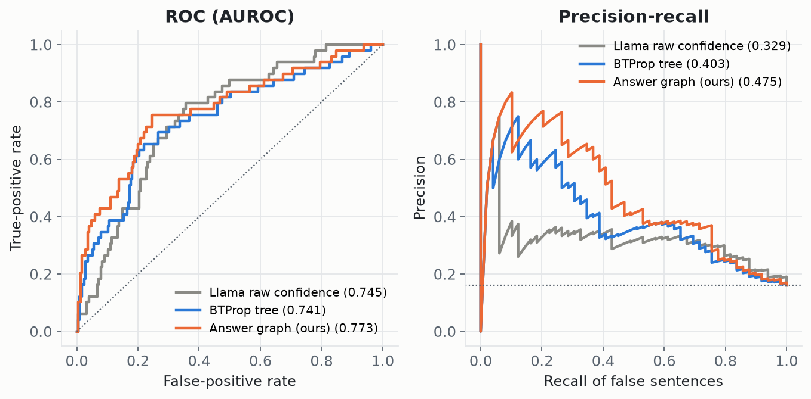

The graph's advantage is concentrated at the top of the ranking: at low recall it finds false
sentences with clearly higher precision (right panel).

### Comparison with the paper (Table 3 of Hou et al.)

| FELM-Science, Llama-3-8B-Instruct | AUROC | AUC-PR | F1 |
|---|---|---|---|
| **Paper** (Table 3): Prior confidence | 76.1 | 38.2 | 44.0 |
| Paper: SelfCheckGPT (best baseline on AUROC) | 77.8 | 39.5 | 49.1 |
| Paper: **BTProp** (depth 2) | **77.8** | **48.2** | **51.3** |
| **Ours**: raw confidence | 74.5 | 32.9 | 37.1 |
| Ours: BTProp reproduction (depth 1) | 74.1 | 40.3 | 43.9 |
| Ours: answer graph (extension 1) | 77.3 | 47.5 | 43.8 |

| Gain over plain confidence | AUROC | AUC-PR | F1 |
|---|---|---|---|
| Paper: BTProp | +1.7 | +10.0 | +7.3 |
| Ours: BTProp reproduction | −0.4 | +7.4 | +6.8 |
| Ours: answer graph | +2.8 | +14.6 | +6.7 |

The *pattern* of the paper's gain reproduces: BTProp barely moves AUROC (+1.7 in the paper, −0.4
here) but clearly improves AUC-PR and F1 (+10.0 / +7.3 in the paper; +7.4 / +6.8 here). Absolute
numbers are not directly comparable: the paper uses its full hand-cleaned FELM-Science file and
depth-2 trees; we use our cleaned version's 304-sentence test half, depth 1, and a cross-fitted F1
cut-off (the paper searches for the F1-optimal threshold on the same data, which is more
favourable). Our answer graph reaches AUROC and AUC-PR within about one point of the paper's
BTProp, but that is a different test set, not a like-for-like win. The "3–9% over the best
baseline" in the paper is an average over datasets and backbones; on Llama-3 and FELM-Science its
AUROC equals SelfCheckGPT's (77.8).

### 6.3 How sure we are (cluster bootstrap, 2,000 resamples of whole answers)

| Comparison | Metric | Mean difference | 95% interval | Resamples > 0 |
|---|---|---|---|---|
| Tree − raw | AUROC | −0.004 | −0.05 to +0.04 | — |
| Tree − raw | AUC-PR | +0.068 | −0.038 to +0.187 | 89% |
| Graph − tree | AUROC | +0.029 | −0.014 to +0.075 | 89% |
| Graph − raw | AUROC | +0.023 | −0.047 to +0.092 | 74% |
| Graph − tree | AUC-PR | +0.063 | −0.044 to +0.197 | 81% |
| **Graph − raw** | **AUC-PR** | **+0.131** | **−0.021 to +0.275** | **95%** |

### 6.4 How the numbers moved

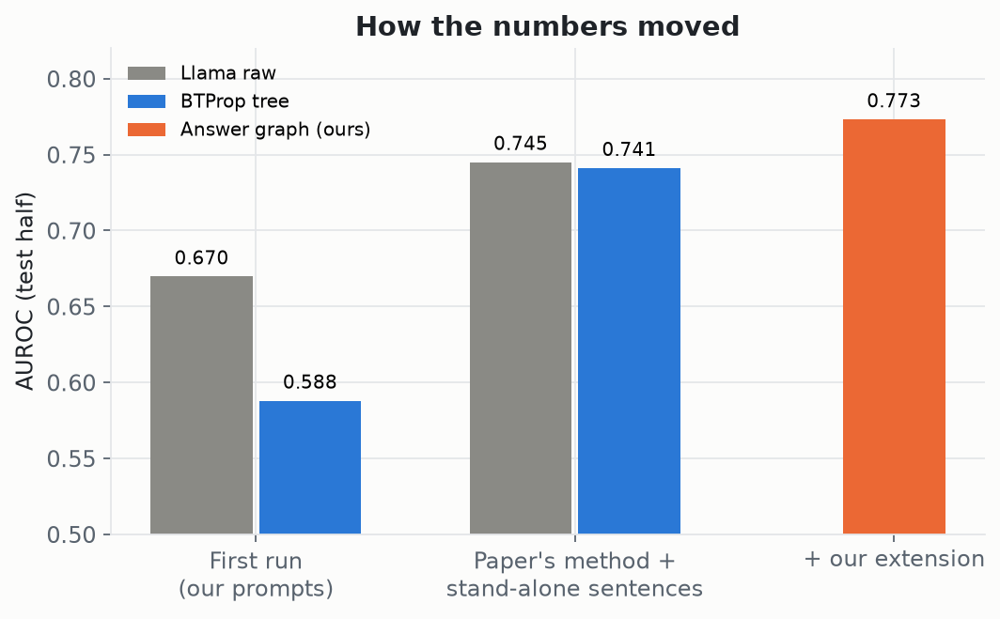

| Stage | Raw AUROC | Tree AUROC | What changed |
|---|---|---|---|
| First Llama run, our own prompts | 0.670 | 0.588 | tree *hurt*: broken table calibration, context-dependent sentences, 98% of sentences over-split |
| Paper's prompts + stand-alone sentences + logistic curve | 0.745 | 0.741 | D27, D29, D30 |
| + answer graph, link rule chosen on fit half | — | **0.773** | D32–D35 |

### 6.5 Loopy BP convergence

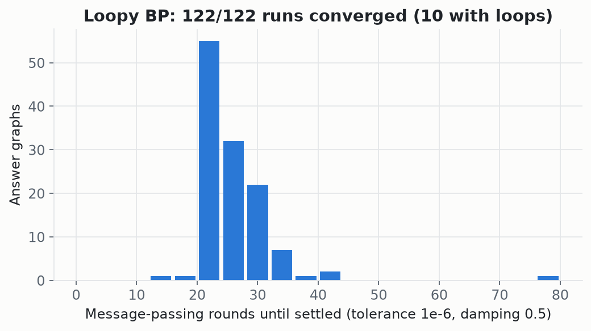

| | Value |
|---|---|
| Answer graphs scored (61 answers × 2 calibrations) | 122 |
| Converged (largest message change < 1e-6) | **122 (100%)** |
| Graphs with real cycles | 10 (all converged) |
| Rounds needed | median ≈ 24, max 76 |
| Cross links kept (test half) | 72: 53 entailment, 15 reverse entailment, 4 equivalence; in 31 of 61 answers |

Correctness checks of the BP code itself (§12): exact on trees to 12 decimals; within 0.05 of a
brute-force answer on a looped graph, and — as expected — not exact.

### 6.6 Surrogate scorer

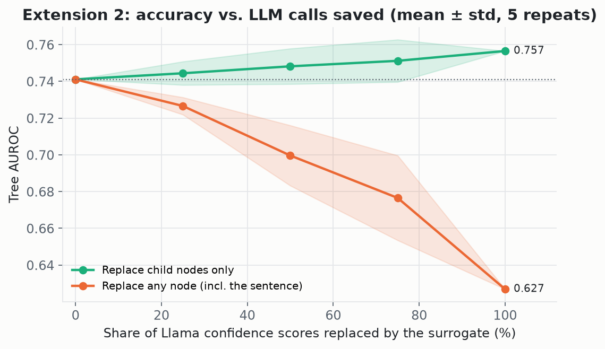

| Replaced | Child nodes only (AUROC) | Any node (AUROC) | Confidence calls saved |
|---|---|---|---|
| 0% | 0.741 | 0.741 | 0 of 812 |
| 25% | 0.744 ± 0.006 | 0.727 ± 0.005 | 127 / 203 |
| 50% | 0.748 ± 0.010 | 0.700 ± 0.016 | 254 / 406 |
| 75% | 0.751 ± 0.012 | 0.677 ± 0.023 | 381 / 609 |
| 100% | **0.757** | 0.627 | **508 (63%)** / 812 |

| Mean absolute error vs. Llama's confidence | All nodes | Sentences | Children |
|---|---|---|---|
| Surrogate | 0.247 | 0.276 | 0.230 |
| Always predict the average | 0.258 | 0.281 | 0.244 |

### 6.7 Loopy BP versus exact inference as loops increase

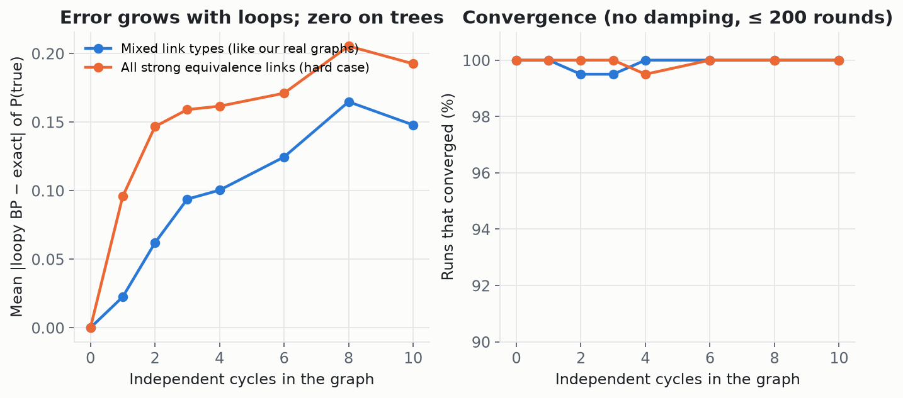

Synthetic study (`scripts/loopiness_study.py`, decision D37): 200 random 10-node graphs per
setting — a random spanning tree plus 0–10 extra edges — with exact marginals by brute force.
Loopy BP is exact on trees; its mean error rises with loops (mixed links: 0.023 at one cycle,
0.094 at three, 0.148 at ten; all-strong links: 0.096, 0.159, 0.193) with worst single errors up
to 0.85. Convergence was at least 99.5% undamped; damping 0.5 did not help (at least 97%, about
twice the rounds). On our real answer graphs, 26 of the 31 linked test answers are loop-free
(where BP is exact) and 5 contain a cycle, so the gain in §6.2 comes mostly from linking
sentences; the loopy part would matter more on denser graphs.

---

## 7. Discussion

- **Reproduction.** With the paper's prompts and stand-alone sentences, our BTProp tree matches
  raw confidence on AUROC (as in the paper, +1.7 there) and improves AUC-PR and F1 by about the
  same amount the paper reports (+7.4 / +6.8 here against +10.0 / +7.3); see the comparison
  table in §6.2. The remaining absolute gap is most likely depth 1 instead of 2, an automatic
  instead of a hand-cleaned dataset, a stricter cross-fitted F1, and a small test set.
- **The biggest single fix was data, not modelling.** Making sentences stand alone raised raw
  AUROC from 0.670 to 0.745; context-dependent "They / This…" sentences had scored 0.40.
- **Answer graphs help, once the links are right.** All NLI links together hurt (0.727), because
  the NLI model over-calls contradictions between different facts on one topic. Supportive links
  alone, chosen on the fit half, give the best result on every metric. Sentences that a
  confident neighbour entails are pulled up; the false ones, lacking support, stand out.
- **Loopy BP was a non-issue in practice.** Every graph converged, typically in ~24 rounds,
  because answer graphs are small and the softened links are weak enough not to oscillate.
- **The surrogate result says as much about trees as about cost.** The surrogate is barely better
  than predicting the average, yet replacing *every* child score costs nothing (0.741 → 0.757).
  So the children's real Llama scores carried little extra information at depth 1 — consistent
  with tree ≈ raw. The sentence's own score, in contrast, is essential: replacing it degrades
  AUROC steadily.

---

## 8. Limitations

- **One dataset, small test set.** 49 false sentences: AUROC differences below ~0.05 cannot be
  separated from chance. Only "graph vs. raw, AUC-PR" clears 95%, narrowly.
- **Depth 1 trees** (paper: 2), limited by free GPU time.
- **Approximate data cleaning.** Automatic stand-alone rewriting replaces the paper's hand-cleaned
  file; the NLI check is conservative and rejected some good rewrites.
- **Contradictions between sentences are unused** under the chosen rule; a real one
  ("…in Berlin" / "…in Paris") is missed. A more reliable contradiction detector could restore
  them.
- **Links only between sentence roots**, not between premises of different sentences.
- **Transition probabilities are the official hand-set values**, not learned.
- **The surrogate saves only confidence calls**; generating premises and corrections still needs
  the LLM.
- **The official prompts are copied** from a repository without a licence file (credited, D29).

---

## 9. Reproducing everything

### 9.1 Setup

Python 3.13 and [uv](https://docs.astral.sh/uv/).

```bash
git clone https://github.com/Mahakisore7/Reason-Graph.git && cd Reason-Graph
uv sync                 # dependencies into .venv
uv run pytest           # 77 tests; no GPU, model download or API key needed
```

Optional GPU on a laptop: `uv sync` installs CPU PyTorch. For an NVIDIA GPU (NLI becomes minutes
instead of hours):

```bash
uv pip install --python .venv --no-deps "torch==2.14.1+cu126" --index-url https://download.pytorch.org/whl/cu126
PYTHONPATH=. .venv/Scripts/python.exe scripts/<script>.py …    # Windows (.venv/bin/python elsewhere);
                                                               # `uv run` may reinstall the CPU build
```

Optional Groq key for the demo: copy `.env.example` to `.env`, set `GROQ_API_KEY`, then
`export $(grep '^GROQ_API_KEY=' .env)`. Never commit `.env`.

### 9.2 Stage 1 — Llama on Kaggle (≈ 5–7 h, free)

Import `notebooks/kaggle_felm_llama3.ipynb`, attach the `GITHUB_TOKEN` secret, GPU T4 ×2,
Internet on, *Save & Run All* — full guide in
[docs/project-log/07-running-on-kaggle.md](docs/project-log/07-running-on-kaggle.md). It runs:

```bash
python scripts/decontextualize_felm.py --backend hf                 # §5.2
python scripts/fit_emission_model.py   --backend hf --standalone    # §4.5, fit half
python scripts/evaluate_felm.py        --backend hf --standalone    # BTProp tree, test half
python scripts/evaluate_graph.py       --backend hf --standalone    # answer graph, all links
python scripts/evaluate_surrogate.py   --backend hf --standalone    # §4.7
```

Download `reason_graph_results.zip` (Output tab) and unzip it into the repository root.

### 9.3 Stage 2 — replay on any machine (`--offline`, no Llama)

```bash
python scripts/choose_link_rule.py --backend hf --standalone --offline                 # fit half → rule
python scripts/evaluate_graph.py   --backend hf --standalone --offline --link-rule no_contradiction
python scripts/evaluate_surrogate.py --backend hf --standalone --offline
python scripts/report_metrics.py                                                       # §6.2 table
python scripts/make_figures.py                                                         # docs/figures/
```

### 9.4 Outputs

| File in `results/` | Contents |
|---|---|
| `felm_science_standalone_<model>.json` | every rewrite, rejected rewrites, counts |
| `emission_model_felm_science_<model>-standalone.json` | bucket table, logistic fit |
| `felm_science_auroc_<model>-standalone.json` | per-sentence raw / calibrated / tree scores |
| `felm_science_graph_<model>-standalone[-<rule>].json` | per-answer sentences, links, per-run convergence |
| `link_rule_choice_<model>-standalone.json` | fit-half comparison of link rules |
| `felm_science_surrogate_<model>-standalone.json` | surrogate error and delegation curve |
| `felm_science_metrics_<model>-standalone.json` | AUROC / AUC-PR / F1 for every variant |

---

## 10. Demo and API

```bash
python scripts/verify.py --backend groq "The Eiffel Tower, completed in 1889, is located in Berlin."
```

```
[root, -, confidence 0.00] The Eiffel Tower, completed in 1889, is located in Berlin.
    [decomposition, contradiction, confidence 1.00] The Eiffel Tower was completed in 1889.
    [decomposition, reverse_entailment, confidence 0.00] The Eiffel Tower is located in Berlin.
P(true) = 0.224 -> LIKELY HALLUCINATION
```

`--answer "Sentence one." "Sentence two." …` scores sentences together with the answer graph and
prints tree-only vs. graph probabilities, the links and convergence. (Groq types out its
confidence instead of giving token probabilities — fine for a demo; reported numbers use Llama.)

```python
from src.pipeline import verify_statement, verify_answer

result = verify_statement(llm, labeler, calibration, "Some claim.")
result.posterior_true, result.is_trustworthy, result.raw_tree     # probability, verdict, working

answer = verify_answer(llm, labeler, link_labeler, calibration, ["Sentence 1.", "Sentence 2."])
answer.posterior_true, answer.tree_only, answer.links, answer.converged
```

---

## 11. Repository guide

```
Reason-Graph/
├── src/
│   ├── llm/          base.py (protocol) · hf_client.py · groq_client.py · openai_client.py
│   │                 cache.py (disk cache) · fake.py (tests) · prompts.py (official prompts)
│   ├── tree/         strategies.py · builder.py · nli_labeler.py · relationships.py
│   ├── inference/    hmt.py (exact tree BP, emissions) · loopy.py (factor graph, loopy BP)
│   ├── surrogate/    embedder.py (hashing) · model.py (ridge)
│   ├── eval/         metrics.py (AUROC, AUC-PR, cross-fitted F1)
│   └── pipeline.py   verify_statement · verify_answer
├── scripts/          backends.py · decontextualize_felm.py · fit_emission_model.py
│                     evaluate_felm.py · evaluate_graph.py · choose_link_rule.py
│                     evaluate_surrogate.py · report_metrics.py · make_figures.py · verify.py
├── tests/            77 tests (one module per component)
├── notebooks/        kaggle_felm_llama3.ipynb
├── docs/
│   ├── project-log/  plain-language record: big picture, what we built, decisions D1–D37,
│   │                 dataset, results, glossary, Kaggle guide
│   ├── phases/       original phase-by-phase plan
│   └── figures/      all figures in this README
├── results/          experiment outputs (JSON)
└── llm_cache/        cached LLM answers (gitignored; from the Kaggle zip)
```

New to the project? Read [docs/project-log/README.md](docs/project-log/README.md) →
[01-big-picture.md](docs/project-log/01-big-picture.md) →
[06-glossary.md](docs/project-log/06-glossary.md).

---

## 12. Engineering and verification

| Practice | Detail |
|---|---|
| Tests | 77, all passing. Probability code checked against **hand-computed** values and **brute-force** enumeration, not just "it runs" |
| Exact BP | Phase-0 checkpoints computed on paper (e.g. two-child tree: 0.8209483368719038) |
| Loopy BP | equals exact BP on trees (independent-children and decomposition) to 1e-12; within 0.05 of brute force on a cycle and deliberately *not* exact; 0 rounds ⇒ "not converged" |
| Pipeline | decomposition tree = the same tree built by hand; premise + correction tree = brute force over all 8 truth combinations (catches a child using the wrong relationship) |
| Refactor safety | after moving code into `src/pipeline.py`, the full FELM evaluation was re-run: every sentence's score identical |
| Leakage guards | split by answer; calibration, link rule and F1 cut-offs never see the sentences they score; surrogate cross-fitted by answer |
| Caching | every LLM call cached on disk, cache tags versioned by method (D31) so old answers are never reused under new prompts |
| Static checks | `ruff` (lint + format), `mypy --strict`, pre-commit hooks |

```bash
uv run ruff check . && uv run ruff format --check .
uv run mypy
uv run pytest
```

---

## 13. Design decisions

Every decision is logged with its reason in
[docs/project-log/03-decisions.md](docs/project-log/03-decisions.md). The ones that shape the
results:

| # | Decision |
|---|---|
| D1 | Write our own implementation from scratch |
| D9–D10 | NLI in both directions, `label(child, parent)`; DeBERTa-v3-large |
| D13–D14 | FELM-Science, raw `all.jsonl` from Hugging Face |
| D15 | The paper's 5 calibration buckets |
| D16 | Depth-1 trees (free-GPU budget) |
| D18 | Calibration and test on separate halves, split by answer |
| D19, D26 | Remove non-claims, duplicates and list openers |
| D21–D23 | Free, open-source models only; Llama-3-8B on Kaggle; one Groq account only |
| D27 | Logistic calibration curve beside the bucket table |
| D28 | Report every variant; disclose any second look at the test half |
| D29 | Trees built exactly as the official BTProp code does |
| D30 | Stand-alone rewriting with an NLI faithfulness check |
| D31 | Cache entries versioned by method |
| D32 | Loopy BP on a factor graph with joint factors |
| D33 | One graph per answer, softened cross links |
| D34 | Surrogate trained on LLM confidences, cross-fitted by answer |
| D35 | Cross-link rule chosen on the fit half |
| D36 | AUC-PR and cross-fitted F1; cluster bootstrap |

---

## 14. References and credits

1. B. Hou, Y. Zhang, J. Andreas, S. Chang. *A Probabilistic Framework for LLM Hallucination
   Detection via Belief Tree Propagation.* NAACL 2025. Prompts in `src/llm/prompts.py` are copied
   from the official code, with attribution (D29).
2. S. Chen et al. *FELM: Benchmarking Factuality Evaluation of Large Language Models.* NeurIPS
   2023 Datasets and Benchmarks. Data: `hkust-nlp/felm`.
3. P. He et al. *DeBERTaV3.* ICLR 2023; NLI checkpoint `cross-encoder/nli-deberta-v3-large`
   (Sentence-Transformers).
4. Meta AI. *Llama 3* (Llama-3-8B-Instruct), via `NousResearch/Meta-Llama-3-8B-Instruct`.
5. J. Pearl. *Probabilistic Reasoning in Intelligent Systems.* 1988 — belief propagation.
   K. Murphy, Y. Weiss, M. Jordan. *Loopy Belief Propagation for Approximate Inference: An
   Empirical Study.* UAI 1999.
6. J. Platt. *Probabilistic Outputs for Support Vector Machines.* 1999 — logistic calibration.

License: Apache 2.0 (`LICENSE`).
