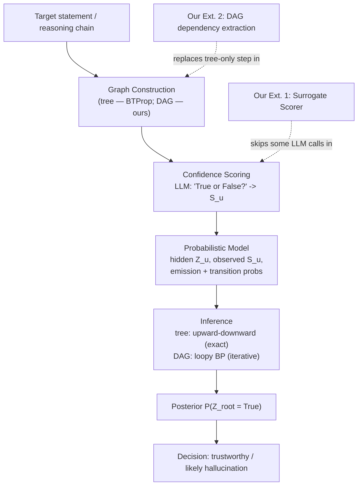
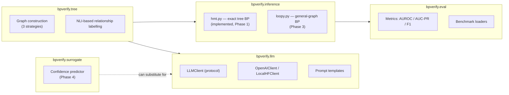
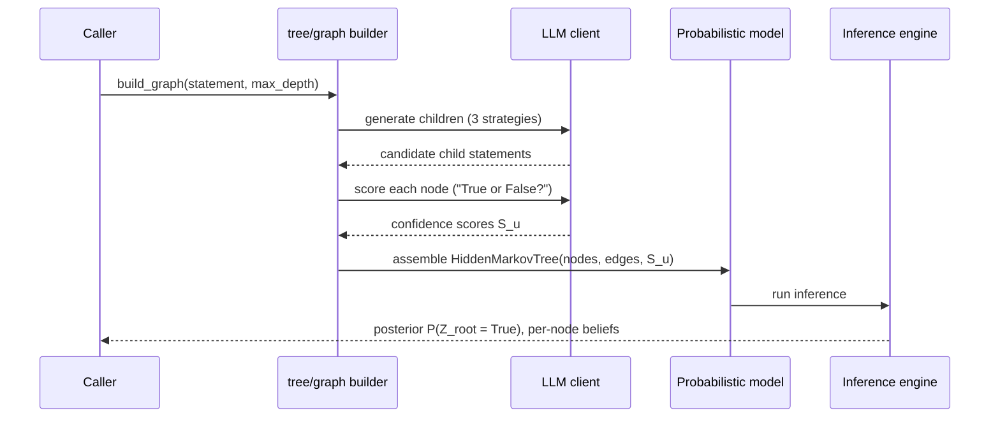

# Architecture

## System Overview

The pipeline turns one target statement (or one full reasoning chain) into a corrected,
logically-consistent probability that it's trustworthy. Blue = base paper (BTProp); this is our
system boundary either way, extended where marked.



## Module Boundaries

Each stage above maps to one Python package under `src/bpverify/`, kept independent so any one
can be unit-tested and swapped without touching the others.



**Design rule:** `bpverify.inference` never imports `bpverify.llm` directly — it only consumes
plain data (a graph of nodes with observed scores). This is what makes `hmt.py` fully unit-testable
with hand-constructed numbers and no network access, no API key, and no mocking required (see
`tests/test_hmt.py`).

## Data Flow (single verification request)



## Why a Tree Structure Is Implemented First (Phase 1), Before the DAG (Phase 3)

The exact upward-downward recursion only works because a tree guarantees each node has exactly
one parent — this is what makes the base algorithm both correct-by-construction and the simplest
possible thing to get right first. Building `hmt.py` (tree case) before `loopy.py` (general DAG) is
deliberate risk sequencing: prove the core math against hand-computed examples on the easy case
before adding the part (cyclic message passing, convergence checking) that has no formal guarantee.

## Suggested Repository Layout

```
bp-verify/
├── docs/                    # this folder — planning + architecture + research notes
├── src/bpverify/
│   ├── tree/                # Phase 2: graph construction (3 strategies) + NLI labelling
│   ├── llm/                 # Phase 1: LLM client protocol + implementations + prompts
│   ├── inference/
│   │   ├── hmt.py           # Phase 0: exact upward-downward algorithm on a tree
│   │   └── loopy.py         # Phase 3: general-graph loopy BP
│   ├── surrogate/           # Phase 4: cheap confidence predictor
│   ├── eval/                # Phase 2/7: metrics + benchmark loading
│   └── pipeline.py          # Phase 5: end-to-end wiring
├── tests/                   # pytest — one test module per src package, written by you
├── scripts/                 # small CLI entry points (reproduce baseline, run eval, etc.)
├── notebooks/               # exploratory analysis, created as needed (gitignored outputs)
└── data/                    # gitignored — local copies of FELM-Science, FactCheckGPT, etc.
```
