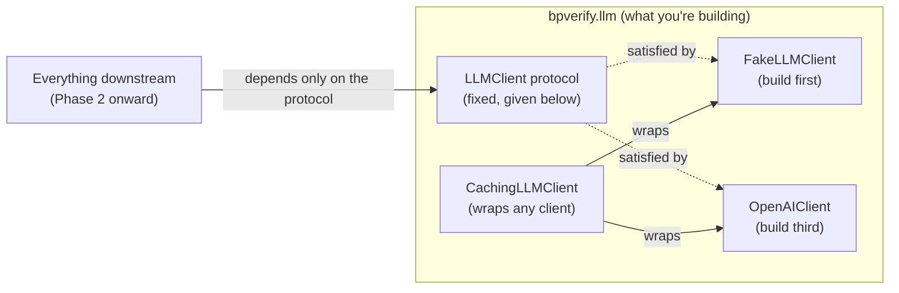

# Phase 1 — LLM Access Layer

## Overview

Everything from here on needs to talk to an LLM. This phase builds that access layer — and,
critically, builds it so that *nothing downstream ever depends on which provider you picked*. Get
this abstraction right now and swapping providers later (or running against a fake for tests) is a
non-event; get it wrong and it's a rewrite.

**Read `docs/05-llm-provider-choice.md` before writing any provider-specific code** — it covers a
concrete technical trap (Grok's current models silently ignore the `logprobs` parameter this
project's confidence-scoring method depends on) that's worth knowing before, not after, you've
built around the wrong provider.

## Concepts You Need First

- **Dependency inversion** — code that needs "something that can generate text and score
  confidence" should depend on an abstraction (a `Protocol` in Python) describing *what* it needs,
  never on a specific concrete class describing *how* one particular provider does it.
- **Composition over inheritance** — instead of a `CachedOpenAIClient` subclass, build a
  `CachingLLMClient` that *wraps* any object satisfying the protocol. The same caching wrapper
  works over OpenAI, a local model, or a test fake, without any of them knowing caching exists.
- **Token log-probabilities** — internally, for each token an LLM outputs, it computed a
  probability distribution over its entire vocabulary before sampling from it. Some APIs expose
  that distribution (or its top-k) for tokens you specify — this is what "logprobs" means, and
  it's the actual mechanism behind this project's confidence scoring (prompt "True or False?" and
  read off the probability mass on the words "True" and "False").
- **Retries with backoff** — API calls fail transiently (rate limits, timeouts) far more often
  than you'd expect at any real volume. A retry with exponential backoff turns "the whole
  experiment crashed at 2am" into "it took three extra seconds on one call."

## Architecture



## The Contract You're Building Against

### `base.py` — the protocol (fixed; implement against this, don't change its shape)

```python
"""The LLMClient protocol every backbone implementation must satisfy.

Kept deliberately small: two methods cover everything the rest of the pipeline needs.
bpverify.inference never imports this module (module-boundary rule, docs/01-architecture.md) --
only bpverify.tree and bpverify.surrogate depend on it.
"""

from __future__ import annotations

from typing import Protocol


class LLMClient(Protocol):
    """Anything that can generate text and score a statement's truthfulness."""

    def complete(self, prompt: str, *, max_tokens: int = 512, temperature: float = 0.0) -> str:
        """Free-form text completion. Used by the three child-generation strategies
        (Decomposition, Premises, Correction) -- docs/04-research-notes-btprop.md, Step 1."""
        ...

    def true_false_confidence(self, statement: str) -> float:
        """Confidence in [0,1] that `statement` is true. Matches BTProp's own scoring method:
        prompt "True or False? {statement}" and normalise the model's own next-token
        probabilities for "True" vs "False" (docs/04-research-notes-btprop.md, Step 3). A
        first-class method rather than something built on `complete` because it fundamentally
        needs token-level probabilities, not just a text string back."""
        ...
```

### `fake.py` — build this first

```python
"""A deterministic, canned LLMClient for tests -- never makes a network call. This is what
makes bpverify.tree (Phase 2) unit-testable with zero API key and zero flakiness.
"""

from __future__ import annotations

from dataclasses import dataclass, field


@dataclass
class FakeLLMClient:
    """Canned responses keyed by exact prompt/statement text, plus call counters for assertions.

    TODO: implement complete() and true_false_confidence().
        - complete: look up `prompt` in self.completions. If missing, raise a clear KeyError with
          a helpful message (not a silent empty string). Increment complete_call_count.
        - true_false_confidence: look up `statement` in self.confidences, falling back to
          self.default_confidence if not found. Increment confidence_call_count.

    Example of how this should behave once built:
        client = FakeLLMClient(
            completions={"decompose: The sky is blue and grass is green": "The sky is blue.\\nGrass is green."},
            confidences={"The sky is blue.": 0.95, "Grass is green.": 0.9},
        )
    """
    completions: dict[str, str] = field(default_factory=dict)
    confidences: dict[str, float] = field(default_factory=dict)
    default_confidence: float = 0.5

    complete_call_count: int = field(default=0, init=False)
    confidence_call_count: int = field(default=0, init=False)

    def complete(self, prompt: str, *, max_tokens: int = 512, temperature: float = 0.0) -> str:
        raise NotImplementedError

    def true_false_confidence(self, statement: str) -> float:
        raise NotImplementedError
```

### `cache.py` — build this second

```python
"""Disk-based response caching -- wraps any LLMClient, adds nothing else. Composition, not
inheritance: this should wrap an object satisfying LLMClient and delegate, so caching can be
added to ANY implementation without that implementation knowing caching exists.
"""

from __future__ import annotations

import json
from dataclasses import dataclass
from pathlib import Path
from typing import Any

from bpverify.llm.base import LLMClient


def _hash_key(*parts: Any) -> str:
    """TODO: implement. Turn `parts` into a stable, unique string key -- think about
    json.dumps(..., sort_keys=True) plus hashlib to get a filesystem-safe filename. Two calls
    with the SAME arguments must produce the SAME key; two calls with even slightly DIFFERENT
    arguments (e.g. different temperature) must produce a DIFFERENT key -- this second property
    is the one that's easy to get subtly wrong, and worth a dedicated test for.
    """
    raise NotImplementedError


@dataclass
class CachingLLMClient:
    """Wraps `inner` and caches every call to disk under `cache_dir`, keyed by a hash of its
    exact arguments.

    TODO:
        - __post_init__: make sure cache_dir exists (create it if not).
        - complete() / true_false_confidence(): compute a cache key from ALL arguments that
          affect the result (not just the prompt/statement -- temperature and max_tokens matter
          too). If a file for that key exists, read and return it WITHOUT calling self.inner.
          Otherwise call self.inner, write the result to disk, and return it.

    Design question worth sitting with: should the cached file contain just the bare result, or
    the result plus the inputs that produced it? (Storing inputs too makes the cache directory
    debuggable by just reading a file, at the cost of a slightly larger file.)
    """
    inner: LLMClient
    cache_dir: Path
    model_tag: str = "default"

    def __post_init__(self) -> None:
        raise NotImplementedError

    def complete(self, prompt: str, *, max_tokens: int = 512, temperature: float = 0.0) -> str:
        raise NotImplementedError

    def true_false_confidence(self, statement: str) -> float:
        raise NotImplementedError
```

### `prompts.py` — write your own wording

Plain functions returning strings, one per prompt need. Write your own phrasing — the research
notes describe WHAT each needs to achieve, not exact text to transcribe:

- `true_false_confidence_prompt(statement)` — needs to elicit a single-word True/False answer, so
  reading next-token logprobs for exactly those two words is meaningful.
- `decomposition_prompt(statement)` — ask whether the statement bundles multiple separate facts;
  if so, split into a list such that the statement is true iff every fact is true; if already
  atomic, signal that some way your parser can detect.
- `premises_prompt(statement)` — ask for premises that would SUPPORT the statement, and separately
  ones that would CONTRADICT it, in a format you can reliably parse back apart.
- `correction_question_prompt(statement)` — ask the single key factual question this statement
  depends on.
- `correction_answer_prompt(question)` — sample an answer to that question.
- `correction_statement_prompt(statement, question, answer)` — rewrite the statement to be
  consistent with a sampled answer.
- `nli_relationship_prompt(premise, hypothesis)` — only needed if you use an LLM-based NLI
  fallback instead of a dedicated NLI model (Phase 2 discusses both options); ask whether the
  premise entails, contradicts, or is unrelated to the hypothesis.

### `openai_client.py` — build this third, once the two fakes above are tested

```python
"""A real, API-backed LLMClient implementation. Read docs/05-llm-provider-choice.md before
picking a provider -- Grok's current models silently ignore the logprobs parameter this class
depends on. Requires the `llm` optional dependency group.
"""

from __future__ import annotations

from dataclasses import dataclass
from typing import Any


@dataclass
class OpenAIClient:
    """Implements the LLMClient protocol against an OpenAI-compatible chat completions API.

    model: e.g. "gpt-3.5-turbo-0125" -- one of the two backbones BTProp itself evaluates
        against, for directly comparable numbers.
    api_key: if None, fall back to the OPENAI_API_KEY environment variable -- NEVER hard-code a
        key in this file or anywhere in the repo.

    TODO, in order:
        1. _client(): construct and return an openai.OpenAI client (import `openai` locally,
           inside the method, so this module doesn't hard-require the package just to be
           imported). Check the CURRENT OpenAI Python SDK docs for the exact constructor --
           this has changed across SDK versions.
        2. complete(): call .chat.completions.create(...) with model, a single user message
           built from `prompt`, max_tokens, and temperature. Return the first choice's text.
        3. true_false_confidence(): the one needing care. Build the prompt with your own
           true_false_confidence_prompt(). Call the completions endpoint with
           logprobs=True, top_logprobs=5 (check current SDK docs for exact parameter names) and
           max_tokens=1. Pull the top-logprobs list for the first generated token, convert each
           entry's logprob to a probability (math.exp), find the probability mass for "true" and
           "false" (case-insensitive, stripped), and normalise: p_true / (p_true + p_false).
           Decide what to return if NEITHER token appears in the top-k list (0.5 is a defensible
           default -- make it deliberate, not an accident).
        4. Add retry/backoff (the `tenacity` package) around both methods for transient errors
           (rate limits, timeouts). A genuine, non-transient failure should still raise loudly.

    Before trusting this class at all: run the confirmation check in
    docs/05-llm-provider-choice.md ("How to confirm this yourself") with your own API key.
    """
    model: str = "gpt-3.5-turbo-0125"
    api_key: str | None = None

    def _client(self) -> Any:
        raise NotImplementedError

    def complete(self, prompt: str, *, max_tokens: int = 512, temperature: float = 0.0) -> str:
        raise NotImplementedError

    def true_false_confidence(self, statement: str) -> float:
        raise NotImplementedError
```

## Verify Your Own Work

`FakeLLMClient` and `CachingLLMClient` need no external service to test — that's the point. Your
own `tests/test_llm_cache.py` should specifically check:

- Calling `complete()` twice with the *same* arguments through a `CachingLLMClient` calls the
  wrapped (inner) client only **once** — assert on the inner fake's own call counter.
- Calling `complete()` twice with the *same prompt* but *different* `temperature` calls the inner
  client **twice** — the regression test for the cache-key subtlety above.
- A fresh `CachingLLMClient` pointed at the same `cache_dir` (new Python object, same directory)
  still sees an earlier instance's cached results — this is what makes caching survive across
  separate script/notebook runs.

`OpenAIClient` needs a real key to verify — do this once, deliberately: send one request with
`logprobs=True, top_logprobs=5`, print the raw response, confirm the field is genuinely populated
before building anything on top of it.

## Production Practices Applied Here

- **Secrets never touch the repo.** Read your API key from an environment variable — never
  hard-code it, never commit a `.env` file (already gitignored).
- **Retry transient failures; never swallow real ones.**
- **Cache to disk, not memory** — the point is surviving across separate runs, not just one
  process's lifetime.

## Suggested File Structure

```
src/bpverify/llm/
├── __init__.py
├── base.py              # the protocol -- fixed
├── fake.py               # build first
├── cache.py               # build second
├── openai_client.py        # build third
└── prompts.py               # your own wording
tests/
└── test_llm_cache.py
```

## Git Workflow Checkpoint

Branch: `phase-1/llm-client`. Small commits per class. Tag `phase-1-complete` once your tests
pass and you've confirmed a real API call works.

## Definition of Done

- [ ] `FakeLLMClient`, `CachingLLMClient` implemented and tested — zero network access needed.
- [ ] `OpenAIClient` (or your chosen provider's equivalent) implemented, logprobs behaviour
      personally confirmed with a real key.
- [ ] Prompt templates written in your own wording.
- [ ] `uv run ruff check .` and `uv run mypy` clean.

## Common Pitfalls

- **Don't let `bpverify.llm` depend on `bpverify.tree` or `bpverify.inference`** — the dependency
  arrow only ever points the other way.
- **Don't assume a provider's logprobs support is permanent** — re-check whenever you change
  models, not just once at the start.
- **Build `FakeLLMClient` before `OpenAIClient`** — you'll want the fake for every phase from here
  on, and building it first forces you to nail down the protocol's exact behaviour without also
  debugging a real network call at the same time.
