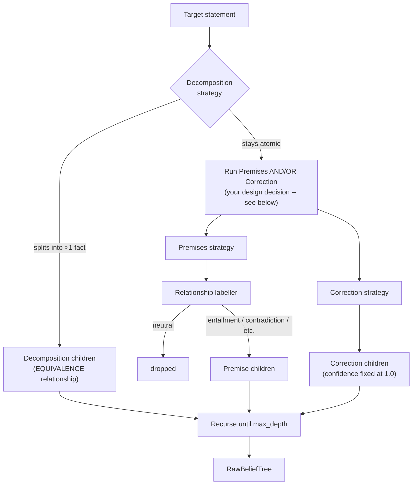

# Phase 2 — Reproduce the Baseline

## Overview

This phase builds the actual belief-tree construction from BTProp — the three child-generation
strategies, relationship labelling, and the orchestration that ties them together — and then
proves your reimplementation is faithful by reproducing (roughly) the paper's own reported
accuracy on a real benchmark.

**This is the sanity-check gate for the whole project.** Before you build anything in Phase 3/4 and
call it an improvement, you need this phase's numbers to be believable. If your reproduction is
far off the paper's own reported AUROC, any later "our extension improves things" claim is
unfalsifiable — you won't know whether a change helped, or just moved further from a bug you
already had.

## Concepts You Need First

- **Factor graph / claim graph** — a set of nodes (claims), each connected to others by an edge
  representing a logical relationship. This phase's job is building one from a starting statement.
- **NLI (Natural Language Inference)** — deciding whether one sentence (hypothesis) is entailed
  by, contradicted by, or unrelated to (neutral with) another (premise). This is how the project
  decides the logical relationship between a parent claim and a candidate child claim.
- **The four relationship types this project uses**: equivalence, entailment, reverse entailment,
  contradiction (plus "neutral," meaning: drop this candidate child, it's unrelated).

## Architecture



## A Design Decision That's Yours to Make

The base paper asks the LLM to *choose* between Premises and Correction with a dedicated prompt
when Decomposition doesn't apply. You have two reasonable options: (a) implement that same
dedicated "which strategy" prompt, most faithful to the paper, or (b) run *both* whenever
decomposition doesn't split — simpler, strictly more thorough, at the cost of more LLM calls per
node. Either is defensible. Pick one **deliberately**, and write a one-line comment in your
`builder.py` saying which you chose and why.

## The Contract You're Building Against

### `relationships.py`

```python
"""Determining the logical relationship between a parent claim and a child claim. Matches
docs/04-research-notes-btprop.md, Step 2: four relationships (equivalence, entailment, reverse
entailment, contradiction), normally decided by an NLI model run in both directions. "neutral"
means the pair is unrelated and the child should be dropped.
"""

from __future__ import annotations

from dataclasses import dataclass, field
from enum import Enum
from typing import Protocol


class Relationship(Enum):
    EQUIVALENCE = "equivalence"
    ENTAILMENT = "entailment"            # premise entails hypothesis
    REVERSE_ENTAILMENT = "reverse_entailment"  # hypothesis entails premise
    CONTRADICTION = "contradiction"
    NEUTRAL = "neutral"                  # unrelated -- caller should drop this child


class RelationshipLabeler(Protocol):
    def label(self, premise: str, hypothesis: str) -> Relationship: ...


@dataclass
class FakeRelationshipLabeler:
    """Canned relationship labels keyed by (premise, hypothesis), for tests.

    TODO: implement label() the same shape as FakeLLMClient -- look up (premise, hypothesis) in
    self.labels, falling back to self.default. Increment call_count.

    Build this before your real NLI-backed labeller. A real implementation (wrapping a
    pretrained NLI checkpoint via Hugging Face `transformers`) runs the model in both directions
    between candidate child and parent, and maps its label space onto this 5-way enum.
    """
    labels: dict[tuple[str, str], Relationship] = field(default_factory=dict)
    default: Relationship = Relationship.NEUTRAL
    call_count: int = field(default=0, init=False)

    def label(self, premise: str, hypothesis: str) -> Relationship:
        raise NotImplementedError


# Fill in starting (p_true_given_parent_true, p_true_given_parent_false) values here, in the
# shape IndependentChildTransition/PairwiseEdge (Phases 0/3) both expect. Meant to be refit
# against real labelled data later (same idea as the emission model) -- but you need SOME
# starting numbers to get a first end-to-end run working. Think about directional sensibility:
# entailment should push the child's truth toward matching the parent's; contradiction toward
# the OPPOSITE; equivalence should be closer to deterministic than either.
DEFAULT_TRANSITION_PARAMS: dict[Relationship, tuple[float, float]] = {
    # Relationship.EQUIVALENCE: (?, ?),
    # Relationship.ENTAILMENT: (?, ?),
    # Relationship.REVERSE_ENTAILMENT: (?, ?),
    # Relationship.CONTRADICTION: (?, ?),
}
```

### `strategies.py`

```python
"""The three belief-tree child-generation strategies (docs/04-research-notes-btprop.md, Step 1).
Each is a pure function of (LLMClient, statement) -> structured children -- easy to unit test
independently with FakeLLMClient.
"""

from __future__ import annotations

import re
from dataclasses import dataclass
from enum import Enum

from bpverify.llm.base import LLMClient
from bpverify.llm.prompts import (
    correction_answer_prompt,
    correction_question_prompt,
    correction_statement_prompt,
    decomposition_prompt,
    premises_prompt,
)


class PremiseStance(Enum):
    SUPPORT = "support"
    CONTRADICT = "contradict"


@dataclass(frozen=True)
class Premise:
    text: str
    stance: PremiseStance


_NUMBERED_LINE = re.compile(r"^\s*\d+[.)]\s*(.+)$")


def decomposition_strategy(llm: LLMClient, statement: str) -> list[str]:
    """Strategy A. Returns the sub-facts if the statement decomposes, or [statement] unchanged
    if already atomic -- callers use len(result) > 1 to decide whether decomposition "took".

    TODO: call llm.complete(decomposition_prompt(statement)), split the response into lines,
    strip numbering (the _NUMBERED_LINE regex above is a hint), return the list -- falling back
    to [statement] if you only got one usable line back.
    """
    raise NotImplementedError


def premises_strategy(llm: LLMClient, statement: str) -> list[Premise]:
    """Strategy B. Parses the LLM's response into typed Premise objects.

    TODO: call llm.complete(premises_prompt(statement)). Parse whatever format you chose in your
    own premises_prompt back into Premise(text=..., stance=...) objects. Lines that don't match
    should be skipped, not crash the whole strategy.
    """
    raise NotImplementedError


def correction_strategy(llm: LLMClient, statement: str, num_samples: int = 2) -> list[str]:
    """Strategy C. Three LLM calls per sample: ask the key question, sample an answer, rewrite
    the statement to match. Nodes produced this way get confidence fixed at 1.0 by the CALLER
    (not this function).

    TODO: call correction_question_prompt once, then loop num_samples times calling
    correction_answer_prompt then correction_statement_prompt, collecting each corrected
    statement. Think about where `temperature` comes from for the answer-sampling calls --
    sampling the SAME answer every time defeats the point of num_samples > 1.
    """
    raise NotImplementedError
```

### `builder.py`

```python
"""Orchestrates the three strategies + relationship labelling + confidence scoring into one
tree.
"""

from __future__ import annotations

from dataclasses import dataclass, field

from bpverify.llm.base import LLMClient
from bpverify.tree.relationships import Relationship, RelationshipLabeler
from bpverify.tree.strategies import (
    correction_strategy,
    decomposition_strategy,
    premises_strategy,
)


@dataclass
class RawNode:
    node_id: str
    statement: str
    confidence: float
    parent_id: str | None
    relationship_to_parent: Relationship | None
    strategy: str  # "root" | "decomposition" | "premise" | "correction"
    children: list[str] = field(default_factory=list)


@dataclass
class RawBeliefTree:
    """Intermediate representation -- statements, confidences, relationships, but not yet an
    inference-ready HiddenMarkovTree/FactorGraph. That conversion needs a *fitted* emission model
    (needs real labelled data) and belongs in Phase 5, not here."""
    nodes: dict[str, RawNode]
    root_id: str


def build_belief_tree(
    llm: LLMClient,
    labeler: RelationshipLabeler,
    root_statement: str,
    *,
    max_depth: int = 2,
    correction_samples: int = 2,
) -> RawBeliefTree:
    """Builds the tree breadth-first from root_statement, stopping at max_depth.

    TODO, outline:
    1. Score the root statement's own confidence, create its RawNode (strategy="root",
       parent_id=None, relationship_to_parent=None).
    2. Process nodes breadth-first (a queue of (node_id, depth) works). For each node at
       depth < max_depth:
       a. Try decomposition_strategy. If it returns more than one sub-fact, add each as a child
          (strategy="decomposition", relationship_to_parent=Relationship.EQUIVALENCE) -- and
          DON'T also try premises/correction for this node.
       b. Otherwise run premises_strategy: for each Premise, label its relationship via
          labeler.label(...); if NEUTRAL, drop it; otherwise add as a child (strategy="premise").
       c. Also run correction_strategy: for each corrected statement, add as a child
          (strategy="correction", confidence FIXED at 1.0, not re-probed).
       d. Enqueue every new child at depth+1.
    3. Return the assembled RawBeliefTree.

    Make sure every RawNode you create also gets appended to its parent's .children list --
    easy to forget, which silently produces unreachable claims.
    """
    raise NotImplementedError
```

## Verify Your Own Work

**Everything through `build_belief_tree` is testable with `FakeLLMClient` + `FakeRelationshipLabeler`
— zero network access needed.** Your own tests should specifically cover:

- `decomposition_strategy` on a statement bundling two facts returns both, in order; on an atomic
  statement, returns `[statement]` unchanged.
- `premises_strategy` correctly separates SUPPORT/CONTRADICT lines and ignores non-matching ones.
- `correction_strategy` with `num_samples=N` makes exactly the LLM calls you'd expect — work this
  out on paper first (question call + N × (answer + rewrite)), then assert the fake's call
  counter matches.
- In `build_belief_tree`: a decomposition child gets `EQUIVALENCE` + `strategy="decomposition"`. A
  `NEUTRAL`-labelled premise/correction child gets **dropped**, not added. A correction child's
  confidence is **fixed at 1.0**, never re-probed. The tree stops growing exactly at `max_depth`.

**Once that's solid, and only then:**

- Wire in a real NLI-backed `RelationshipLabeler` (a pretrained checkpoint via Hugging Face
  `transformers`, run in both directions, mapped onto the 5-way enum).
- Fit a real emission model: take a held-out labelled slice of your chosen dataset, bin observed
  LLM confidence scores into ranges, count how often each occurs among true vs. false statements
  (`docs/04-research-notes-btprop.md`, Step 4).
- Run the whole pipeline on a real, labelled benchmark (FELM-Science — open licence, one of the
  paper's own three) and compute AUROC/AUC-PR against ground truth.
- **Compare to the paper's own reported FELM-Science AUROC.** Within a few points, same backbone,
  is the bar. If far off, debug in order: (1) prompt wording, (2) confidence extraction uses real
  normalised logits not a free-text parse, (3) tree depth/branching matches intent, (4) only then
  suspect the inference math (already independently verified in Phase 0).

## Production Practices Applied Here

- **Test orchestration logic completely separately from LLM content.** Structural bugs (wrong
  relationship, wrong depth, wrong confidence-fixing) should be caught by fast, free, deterministic
  tests before you spend API budget debugging content quality.
- **Parsing should be forgiving, with fallback behaviour written down in a comment.**
- **Write down every "we chose X over Y" decision where it lives** — see the design decision above.

## Suggested File Structure

```
src/bpverify/tree/
├── __init__.py
├── strategies.py
├── relationships.py
└── builder.py
tests/
├── test_strategies.py
└── test_builder.py
scripts/
└── fit_emission_model.py   # once you have labelled data
```

## Git Workflow Checkpoint

Branch: `phase-2/tree-construction`. Tag `phase-2-complete` **only once your reproduced AUROC is
real and documented** — this phase's DoD is about a number, not just code that runs.

## Definition of Done

- [ ] All three strategies implemented and tested against `FakeLLMClient`.
- [ ] `build_belief_tree` implemented and tested, including neutral-drop and
      confidence-fixing behaviours.
- [ ] Real NLI labeller wired in.
- [ ] Emission model fit against real labelled data.
- [ ] Reproduced AUROC on FELM-Science within a few points of the paper's own reported number —
      **do not proceed to Phase 3 until this is real.**

## Common Pitfalls

- **Hand-inspect the dataset** before trusting any metric computed against its labels.
- **The emission table and transition parameters are fit to one labelled slice** — not universal
  constants. Expect some sensitivity across datasets, and that's worth investigating, not hiding.
- **If your reproduced AUROC is far off, don't jump straight to "the math must be wrong."** The
  inference core (Phase 0) is the one part already independently verified against hand
  computation — a mismatch is much more likely in prompt wording, confidence extraction, or tree
  shape.
