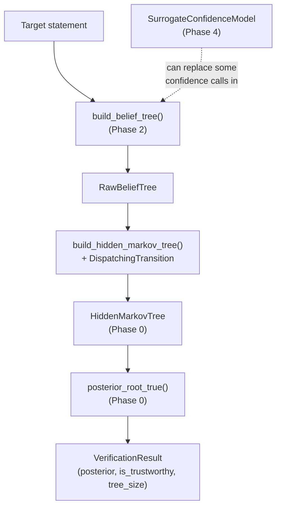

# Phase 5 — Full Assembly

## Overview

Phases 1–4 built independent, independently-tested pieces. This phase wires them into one callable
system — and forces you to confront a real design problem that doesn't show up until you try to
combine everything: a single tree can mix decomposition-strategy children (which need a *joint*
transition rule over a whole sibling set) with premise/correction-strategy children (which need a
*per-child*, relationship-specific rule) — sometimes at different parents within the same tree.

## The Design Problem, Explained Before You Hit It

Phase 0's `HiddenMarkovTree` has ONE shared `transition` object for the whole tree. A single
`IndependentChildTransition` instance can't express "child A uses entailment's parameters, child B
uses contradiction's" — it only knows one pair of numbers.

**A trap worth naming explicitly, because it's tempting and it's wrong:** you might reach for a
mutable "current parent" variable, set by walking the tree once before running inference, then
read by your transition model during the real recursion. This looks plausible and is subtly
broken — a separate pre-pass traversal and the real recursive computation aren't interleaved, so
by the time inference actually calls your transition model at some internal node, the tracked
"current parent" state reflects wherever your pre-pass *finished*, not whichever node inference is
*currently* processing. This was a real mistake made while validating this project's own reference
implementation, caught only by testing against an independently-computed expected value that
didn't match.

**The clean fix:** notice that Phase 0's `TransitionModel.joint_prob()` already takes a
`parent_id` argument (you built `IndependentChildTransition`/`DecompositionTransition` to accept
and ignore it, since neither needed it at the time). That parameter exists for exactly this
moment: a transition model CAN look up which node is currently being evaluated, with no separate
state-tracking needed at all, because the information arrives as a normal function argument every
time it's needed.

If you find yourself reaching for a workaround instead of using information already available to
you through the interface, that's usually a sign to stop and re-examine the interface — not a sign
to add more state-tracking machinery on top of it.

## Architecture



## The Contract You're Building Against

```python
"""End-to-end wiring: statement -> RawBeliefTree -> HiddenMarkovTree -> posterior -> decision.
Closes a specific gap: converting a RawBeliefTree (Phase 2) into an inference-ready
HiddenMarkovTree (Phase 0's posterior_root_true() consumes).
"""

from __future__ import annotations

from dataclasses import dataclass

from bpverify.inference.hmt import EmissionModel, HiddenMarkovTree, TreeNode, posterior_root_true
from bpverify.llm.base import LLMClient
from bpverify.tree.builder import RawBeliefTree, build_belief_tree
from bpverify.tree.relationships import RelationshipLabeler


@dataclass(frozen=True)
class VerificationResult:
    statement: str
    posterior_true: float
    is_trustworthy: bool
    tree_size: int
    raw_tree: RawBeliefTree


class DispatchingTransition:
    """A single TransitionModel (satisfying Phase 0's protocol) for a whole RawBeliefTree, even
    though different parents in that tree may need different rules.

    TODO: implement joint_prob(parent_id, parent_truth, children_truth):
        1. Look up the RawNode for parent_id in the RawBeliefTree you were constructed with.
        2. If it has no children, there's nothing to compute a joint distribution over -- what
           should this return?
        3. Look at the STRATEGY of its first child ("decomposition" vs "premise"/"correction" --
           recall a parent's children never mix decomposition with the other two). If
           decomposition, delegate to a DecompositionTransition instance.
        4. Otherwise, each child is independent, and each carries its OWN
           relationship_to_parent. For each child, look up its transition parameters from
           DEFAULT_TRANSITION_PARAMS (Phase 2) keyed by that relationship, compute that child's
           own pairwise term, and multiply all the children's terms together (this is what
           "independent given the parent" means mathematically).
    """

    def __init__(self, raw_tree: RawBeliefTree) -> None:
        raise NotImplementedError

    def joint_prob(
        self, parent_id: str, parent_truth: bool, children_truth: tuple[bool, ...]
    ) -> float:
        raise NotImplementedError


def build_hidden_markov_tree(raw: RawBeliefTree, emission: EmissionModel) -> HiddenMarkovTree:
    """Converts a RawBeliefTree into an inference-ready HiddenMarkovTree using
    DispatchingTransition.

    TODO: build a dict[str, TreeNode] from raw.nodes (same node_id/score/children, different
    dataclass type), then construct and return a HiddenMarkovTree with
    transition=DispatchingTransition(raw).
    """
    raise NotImplementedError


def verify_statement(
    llm: LLMClient,
    labeler: RelationshipLabeler,
    emission: EmissionModel,
    statement: str,
    *,
    max_depth: int = 2,
    correction_samples: int = 2,
    trust_threshold: float = 0.5,
) -> VerificationResult:
    """The single function tying Phases 0/1/2 together end to end.

    TODO: call build_belief_tree(), then build_hidden_markov_tree(), then posterior_root_true(),
    assemble a VerificationResult. Keep raw_tree on the result -- being able to inspect WHY a
    verdict came out the way it did is worth far more than just the final number, especially the
    first several times a result surprises you.

    NOTE: `emission` must cover every score value the tree can actually produce -- with a real
    LLM, use a real, fitted binned emission model (Phase 2), not a hand-written LookupEmission
    with only a few exact scores.
    """
    raise NotImplementedError
```

## Verify Your Own Work

The strongest test here **cross-validates against work you already trust**, rather than
introducing brand-new expected numbers from nowhere:

**Decomposition path:** build a small `FakeLLMClient`+`FakeRelationshipLabeler` scenario where a
statement decomposes into two sub-facts, run it through `verify_statement`, and **separately**
build the equivalent tree directly with Phase 0's own `HiddenMarkovTree` + `DecompositionTransition`
(no dispatching involved) and call `posterior_root_true` on that directly. The two numbers must
match exactly — if they don't, the bug is in your `DispatchingTransition`'s decomposition-delegation
branch, not in Phase 0's algorithm (already verified independently).

**Premise+correction path (the one that actually exercises heterogeneous relationships):** build a
scenario where a statement gets one premise child (say, `ENTAILMENT`) and one correction child
(confidence fixed at `1.0`, with some relationship you choose, e.g. `CONTRADICTION`). Compute the
expected posterior **independently** — write a short brute-force script enumerating the 2-child
joint space by hand, using each child's own relationship-specific transition parameters — before
running it through your actual `verify_statement`. This is specifically the test that would catch
a `DispatchingTransition` that (incorrectly) applies the same relationship to both children instead
of letting each use its own.

**Also check:** `trust_threshold` changes `is_trustworthy` without changing `posterior_true` (they
should be computed independently — the threshold is a decision rule applied *after* the posterior
is already fixed). A `max_depth=0` tree (root only) should reduce to the same "pure emission ratio"
result as Phase 0's Checkpoint 3.

## Prerequisites

Phases 0–4 each passing their own current Definition of Done.

## Production Practices Applied Here

- **The result object should carry its own evidence** — don't discard `raw_tree`; a trust score
  with no way to inspect what produced it is much harder to debug or explain to a mentor than one
  that keeps its working.
- **Fail loudly on an emission gap** — `LookupEmission` (Phase 0) should raise on an unrecognised
  score. Don't be tempted to make it silently guess once you're wiring real data through it — a
  loud failure here is much easier to debug than a silently wrong number three steps downstream.
- **When an abstraction doesn't fit, extend the abstraction — don't route around it with extra
  state.** This is the single biggest lesson of this phase; see "The Design Problem" above.

## Suggested File Structure

```
src/bpverify/
└── pipeline.py
tests/
└── test_pipeline.py   # including the cross-validation tests above
```

## Git Workflow Checkpoint

Branch: `phase-5/full-assembly`. Tag `phase-5-complete` once both cross-validation tests
(decomposition path and premise+correction path) pass.

## Definition of Done

- [ ] `DispatchingTransition`, `build_hidden_markov_tree`, `verify_statement` implemented.
- [ ] Decomposition path cross-validated exactly against a direct Phase 0 computation.
- [ ] Premise+correction (heterogeneous relationship) path cross-validated against an independent
      brute-force calculation.
- [ ] Runs against a real LLM + real NLI labeller + real fitted emission model.
- [ ] Surrogate-in-the-loop accuracy measured (Phase 4's curve, applied here).
- [ ] *(Stretch, Extension 3)* Applied to real multi-step reasoning traces, using
      `FactorGraph`/`run_loopy_bp` (Phase 3) instead of the tree path for the inference step.

## Common Pitfalls

- **Don't reach for a workaround when the abstraction is the actual problem** — see "The Design
  Problem" above; worth internalising as a general instinct, not just a fact about this function.
- **`LookupEmission` will raise on any score it wasn't built with** — you cannot point
  `verify_statement` at a real LLM using a toy emission table with only a handful of exact scores.
  Build a real binned/interpolated emission model first (Phase 2).
- **If your two cross-validation tests disagree with your hand/brute-force calculations, don't
  suspect Phase 0's algorithm first** — it's the one piece of this whole project independently
  verified against hand-computed examples from the very start. Suspect `DispatchingTransition`'s
  routing logic instead.
