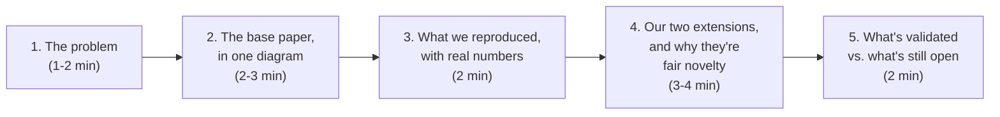

# Phase 6 — Mid-Semester Review Checkpoint

## Overview

Not a coding phase — a checkpoint where what's been built gets explained to your mentor clearly
enough that someone who hasn't been in the code every day can follow it end to end. Everything in
Phases 1–5 has been building toward being able to give this review honestly and confidently.

## What to Actually Present

1. **The problem** — one or two sentences: LLMs reason in steps, a wrong step can invalidate a
   fluent final answer, most detectors only score the final answer.
2. **The base paper, in one diagram** — reuse `docs/01-architecture.md`'s pipeline diagram.
   Resist the urge to re-explain every equation; a mentor unfamiliar with the daily details needs
   the shape of the idea, not a re-derivation. Have the equations ready *if asked*, not as the
   default pace.
3. **What we reproduced, with real numbers** — Phase 2's actual reproduced AUROC next to the
   paper's own reported number. If it's off, say by how much and your best guess why — an honest
   "we're 4 points off and suspect the emission table needs more labelled data" is a stronger
   answer than a suspiciously perfect match with no explanation.
4. **Our two extensions, and why they're fair novelty** — the "old vs. new" framing from
   `docs/03-roadmap.md`'s originating shortlist: BTProp's own authors flagged the cost problem as
   unsolved and left it that way; nobody has generalised the tree to a general graph. Say this
   plainly rather than over-claiming novelty.
5. **What's validated vs. what's still open** — be specific: "loopy BP is cross-validated exact on
   tree-shaped graphs and empirically close on a small synthetic loop; we haven't yet measured
   convergence on real claim graphs" is exactly the kind of precise, honest status a reviewer
   trusts more than a vague "it's working well."

## Production/Communication Practices Applied Here

- **Never present a result you can't currently reproduce on demand.** If asked "run it again right
  now," everything in `docs/phases/phase-0` through `phase-5` that's marked `[x]` should actually
  run — that's the entire point of keeping the test suite green throughout, not just at the end.
- **State uncertainty as a number, not a feeling.** "Converges most of the time" is weaker than
  "converged on 94% of 200 sampled claim graphs, with a max of 23 iterations" — even a rough count
  beats a vibe.
- **Bring the repo, not just slides.** `git log --oneline --grep=feat` (see `docs/git-workflow.md`)
  turns into an instant, real "here's what we built and when" if a mentor asks to see the actual
  work.

## Definition of Done

- [ ] A short deck/demo exists and was rehearsed once, out loud, before the actual review.
- [ ] Every number presented can be reproduced live if asked.
- [ ] Feedback captured in writing immediately after (a dated note in `docs/`, not just memory) —
      the same "write it down where the decision lives" discipline as every other phase.

## Common Pitfalls

- **Don't lead with the hardest equation.** Start from the one-paragraph version
  (`docs/04-research-notes-btprop.md`'s "One Line for Any Review" section is written for exactly
  this moment).
- **Don't hide the Wikibio-GPT3 exception** (the one benchmark where SelfCheckGPT beats BTProp,
  documented in the research notes) — mentioning a limitation you already know about and have
  understood reads as rigor, not weakness.
