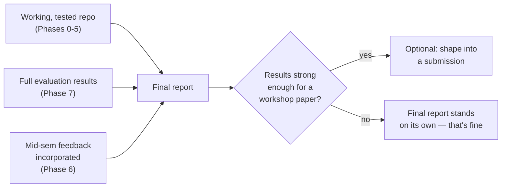

# Phase 8 — Final Review & Write-Up

## Overview

The last phase turns Phases 1–7's work into a deliverable someone outside the project can pick up
cold and understand — including a future version of you, months later.

## What "Done" Looks Like

## Step by Step

1. **Tag the final state**: `git tag final-submission` (see `docs/git-workflow.md`) — an
   unambiguous, permanent pointer to exactly what was submitted.
2. **Write the final report** structured around what's already documented, not from scratch:
   problem/motivation (`docs/00-project-charter.md`) → base paper (`docs/04-research-notes-btprop.md`)
   → our extensions and why they're fair novelty (`docs/03-roadmap.md`'s originating rationale) →
   results (Phase 7) → honest limitations (every phase doc's own "Common Pitfalls" and unchecked
   DoD items are exactly your limitations section, already written).
3. **Make sure the repo itself still explains itself.** `uv sync && uv run pytest` should pass on
   a clean checkout — this is the single best evidence a mentor or future reader has that the
   project is what it claims to be. If it doesn't pass cleanly, fix that before anything else in
   this phase.
4. **Decide honestly on the workshop-submission question.** A "no, and here's why" is a legitimate,
   defensible outcome for a semester project — don't let "should we submit somewhere" become scope
   creep that dilutes the core deliverable.

## Production Practices Applied Here

- **The deliverable is reproducible, not just described.** Every claim in the final report should
  trace back to either a passing test (`tests/`) or a frozen results file
  (`results/final-frozen-*.json`, per Phase 7) — not to "we remember it working."
- **Documentation debt gets paid down, not carried forward.** Any `docs/phases/*.md` checkbox
  still unchecked at this point should be reflected honestly as a limitation in the final report,
  not quietly dropped.

## Definition of Done

- [ ] Final report/demo complete.
- [ ] `uv sync && uv run pytest` passes on a fresh clone, verified by someone who didn't write the
      code (a genuine third-party check, not a rhetorical one).
- [ ] `docs/` and code are in a state a stranger could pick up and understand without you in the
      room.
- [ ] *(Optional)* workshop-submission decision made and recorded, either way.

## Common Pitfalls

- **Don't let the final report claim more than the repo can currently reproduce.** Every number
  quoted should survive someone else running `uv run pytest` and your own eval scripts on a clean
  checkout.
- **Don't bury the honest limitations in a single throwaway sentence.** They're not a formality —
  a reviewer who sees you clearly understand where the work is weak trusts the parts where you say
  it's strong.
