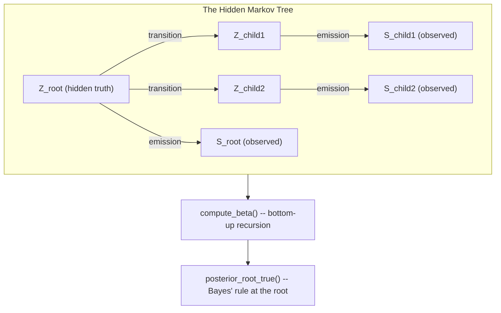

# Phase 0 — Environment Setup & Your First Algorithm

## Overview

This phase has two parts: set up a proper Python project from scratch with production-standard
tooling, then write your first real piece of the project — exact inference on a Hidden Markov
Tree, the probabilistic model behind BTProp. This is deliberately the first algorithm you build:
it has zero external dependencies (no LLM, no API key, no internet), so if it works, you know your
whole environment works, and you've already implemented the mathematical core the rest of the
project sits on top of.

**By the end of this phase you should be able to explain, from memory, what belief propagation on
a tree actually computes and why it's exact — not just recite the formula.**

## Part A — Project Setup

### Tooling choices, and why

| Concern | Choice | Why |
|---|---|---|
| Python version | 3.11+ | Modern typing features (`X \| Y` unions), performance improvements |
| Package/env manager | **uv** | Single tool for venv + install + lockfile; far faster than pip/poetry; a committed lockfile gives every teammate and CI the exact same resolved dependencies |
| Linting + formatting | **ruff** | One fast tool replaces flake8 + isort + black |
| Type checking | **mypy** (strict mode) | Catches "wrong shape of data passed between modules" bugs before they become a debugging session |
| Pre-commit hooks | **pre-commit** | Nobody has to remember to lint; broken code never reaches `main` |
| Testing | **pytest** | Standard, and you'll write your own tests against every phase's checkpoints |

### Set it up

```bash
mkdir bp-verify && cd bp-verify
git init
uv init --python 3.11 --lib   # creates a src-layout package
```

Create `pyproject.toml` with this content (adjust as you learn more — this is a starting point,
not gospel):

```toml
[project]
name = "reason-graph"
version = "0.1.0"
description = "Belief propagation for verifying multi-step LLM reasoning chains (22AIE301 course project)"
readme = "README.md"
requires-python = ">=3.11"
license = { text = "MIT" }
dependencies = [
    "networkx>=3.3",
    "pydantic>=2.7",
    "pydantic-settings>=2.3",
    "tenacity>=8.3",
    "scikit-learn>=1.5",
    "pandas>=2.2",
    "matplotlib>=3.9",
    "numpy>=1.26",
    "pyyaml>=6.0",
]

[project.optional-dependencies]
# Phase 1+ dependencies -- kept optional so Phase 0 (`uv sync`) stays fast and light.
llm = [
    "openai>=1.30",
    "transformers>=4.42",
    "torch>=2.3",
    "sentence-transformers>=3.0",
]

[build-system]
requires = ["hatchling"]
build-backend = "hatchling.build"

[tool.hatch.build.targets.wheel]
packages = ["src"]

[tool.ruff]
line-length = 100
target-version = "py311"

[tool.ruff.lint]
select = ["E", "F", "I", "UP", "B", "SIM", "N"]
ignore = ["E501"]  # line length handled by the formatter, not worth failing CI over

[tool.ruff.format]
quote-style = "double"

[tool.mypy]
python_version = "3.11"
strict = true
files = ["src"]
disallow_untyped_defs = true

[[tool.mypy.overrides]]
# scikit-learn ships no py.typed marker / stubs -- this is the standard way to silence that
# specific noise without weakening strict-mode checking anywhere else.
module = ["sklearn.*"]
ignore_missing_imports = true

[tool.pytest.ini_options]
testpaths = ["tests"]
addopts = "-v --cov=src --cov-report=term-missing"

[dependency-groups]
dev = [
    "pytest>=8.2",
    "pytest-cov>=5.0",
    "ruff>=0.5",
    "mypy>=1.10",
    "pre-commit>=3.7",
]
```

Create `.gitignore`:

```
# Python
__pycache__/
*.py[cod]
.venv/
.pytest_cache/
.mypy_cache/
.ruff_cache/
*.egg-info/
htmlcov/
.coverage

# Data & experiment outputs (never commit raw datasets or LLM response caches)
/data/
/llm_cache/
/results/*.csv
/results/*.json
!/results/.gitkeep

# Notebooks: keep the notebook, not its execution noise
.ipynb_checkpoints/

# OS/editor
.DS_Store
.vscode/
.idea/

# Secrets -- never commit API keys
.env
*.env.local
```

Create `.pre-commit-config.yaml`:

```yaml
repos:
  - repo: https://github.com/astral-sh/ruff-pre-commit
    rev: v0.5.6
    hooks:
      - id: ruff
        args: [--fix]
      - id: ruff-format
  - repo: https://github.com/pre-commit/mirrors-mypy
    rev: v1.10.1
    hooks:
      - id: mypy
        additional_dependencies: [pydantic>=2.7]
        args: [--config-file=pyproject.toml]
  - repo: https://github.com/pre-commit/pre-commit-hooks
    rev: v4.6.0
    hooks:
      - id: trailing-whitespace
      - id: end-of-file-fixer
      - id: check-yaml
      - id: check-added-large-files
        args: [--maxkb=1000]
```

Create `.github/workflows/ci.yml`:

```yaml
name: CI

on:
  push:
    branches: [main]
  pull_request:

jobs:
  test:
    runs-on: ubuntu-latest
    steps:
      - uses: actions/checkout@v4

      - name: Install uv
        uses: astral-sh/setup-uv@v3

      - name: Set up Python
        run: uv python install 3.11

      - name: Install dependencies
        run: uv sync --all-extras

      - name: Lint (ruff)
        run: uv run ruff check .

      - name: Type check (mypy)
        run: uv run mypy

      - name: Test (pytest, with coverage)
        run: uv run pytest
```

Run `uv sync`, confirm it completes without error, run `pre-commit install`, then commit:
`git add -A && git commit -m "chore: initial project scaffold"` (see `docs/git-workflow.md` for
the commit-message convention you should use from here on).

### Suggested file structure

```
bp-verify/
├── pyproject.toml
├── uv.lock                 # generated by `uv sync` -- commit this
├── .gitignore
├── .pre-commit-config.yaml
├── .github/workflows/ci.yml
├── src/
│   ├── __init__.py
│   └── inference/
│       ├── __init__.py
│       └── hmt.py           # <- Part B below
├── tests/
│   └── test_hmt.py            # <- yours to write
├── scripts/
└── notebooks/
```

## Part B — Your First Algorithm

### Concepts You Need First

- **Random variable / prior / posterior / Bayes' Rule** — the basics. A claim's truth is a random
  variable; before evidence you have a prior belief about it; after evidence, a posterior. Every
  algorithm in this project is Bayes' Rule applied efficiently and repeatedly across a graph.
- **Graphical model** — nodes are random variables, edges show which variables directly influence
  which others.
- **Tree-structured graphical model** — no cycles, exactly one parent per node. Trees matter
  because exact probabilistic inference on them is guaranteed fast and exact — no approximation.
- **Belief propagation / the sum-product algorithm** — message-passing: each node sends a summary
  of its belief to its neighbours, and combines incoming messages to update its own. On a tree,
  one pass from leaves to root gives the exact posterior.
- **Hidden Markov Model (the syllabus version)** — a chain of hidden states you can't observe
  directly, each producing a noisy observation you can see, connected by transition probabilities
  (how the hidden state changes) and emission probabilities (how likely an observation is, given
  the hidden state that produced it).
- **Hidden Markov Tree** — the same idea, except hidden states form a tree instead of a chain: a
  node can have several children instead of just one successor. This is exactly what you're
  building.
- **Conditional independence** — a tree model assumes a node's children are conditionally
  independent of each other given the parent. This assumption is *why* the exact recursion below
  works at all — without it, you'd need to consider every child jointly with every other variable
  in the tree, which is intractable for anything but a tiny graph.

### Architecture



`Z_u` = claim `u`'s true (unknown) truthfulness. `S_u` = the LLM's observed confidence score for
claim `u` — in this phase, just a plain float you supply by hand; the LLM doesn't enter the
picture until Phase 1.

### The Contract You're Building Against

Create `src/inference/hmt.py`. This module must end up with **zero dependency on the LLM,
networking, or I/O** — it operates purely on plain data (a tree of node scores + two pluggable
probability models). That's what lets you unit-test it against hand-computed examples with no API
key and no mocking. Build these pieces, in this order:

```python
"""Exact inference on a Hidden Markov Tree via the upward-downward (belief propagation)
algorithm. This is the probabilistic model behind BTProp (Hou et al., NAACL 2025). See
docs/04-research-notes-btprop.md for the full derivation.
"""

from __future__ import annotations

from dataclasses import dataclass, field
from typing import Protocol


@dataclass(frozen=True)
class TreeNode:
    """One claim in the belief tree.

    node_id: unique identifier for this node.
    score: the observed confidence score S_u (e.g. from prompting an LLM with
        "True or False? {statement}" and normalising its next-token probabilities).
    children: IDs of this node's children, in a fixed order (order matters: it must match
        the order your TransitionModel expects for its `children_truth` tuples).
    """
    node_id: str
    score: float
    children: tuple[str, ...] = field(default_factory=tuple)


@dataclass(frozen=True)
class HiddenMarkovTree:
    """A full belief tree plus the probability models needed to run inference on it.

    nodes: every node, keyed by node_id.
    root_id: the node whose posterior truthfulness you ultimately want.
    emission: shared emission model, p(S_u | Z_u).
    transition: shared transition model, p(Z_children | Z_parent).
    prior_true: p(Z_u = True) before observing anything -- the paper uses an uninformative
        0.5 uniformly for every node; keep it a parameter rather than hard-coding it.

    TODO: add a __post_init__ validating that root_id exists in nodes, and that every node's
    children reference IDs that actually exist. Decide what exception type to raise and what
    message helps a caller debug a malformed tree fast.
    """
    nodes: dict[str, TreeNode]
    root_id: str
    emission: "EmissionModel"
    transition: "TransitionModel"
    prior_true: float = 0.5


class EmissionModel(Protocol):
    """p(S_u | Z_u = truth) -- how reliable the LLM's confidence score tends to be."""
    def prob(self, score: float, truth: bool) -> float: ...


class TransitionModel(Protocol):
    """p(Z_children = children_truth | Z_parent = parent_truth), jointly over all children.

    children_truth is a tuple of bools in the same order as TreeNode.children. parent_id is
    passed through so a transition model MAY vary its behaviour per node (you'll want this in
    Phase 5, when one tree mixes decomposition-style and premise/correction-style children); a
    simple model that uses the same rule everywhere can just ignore it.
    """
    def joint_prob(
        self, parent_id: str, parent_truth: bool, children_truth: tuple[bool, ...]
    ) -> float: ...


@dataclass(frozen=True)
class LookupEmission:
    """An emission model backed by an explicit {score: {True: p, False: p}} table.

    TODO: implement prob(). In the base paper this table is fit empirically by binning [0,1]
    into ranges and counting how often each occurs among true vs. false statements
    (docs/04-research-notes-btprop.md, Step 4) -- a Phase 2 upgrade, once you have real labelled
    data. For now: what should happen if `score` isn't a key in `table`? (Hint: fail loudly, don't
    silently guess -- you'll want to know immediately if a real LLM returns an unanticipated
    score.)
    """
    table: dict[float, dict[bool, float]]

    def prob(self, score: float, truth: bool) -> float:
        raise NotImplementedError


@dataclass(frozen=True)
class IndependentChildTransition:
    """Transition model for the Premises / Correction strategies. Each child is conditionally
    independent of its siblings given the parent (docs/04-research-notes-btprop.md, Step 4).
    p_true_given_parent_true / p_true_given_parent_false give p(child=True | parent=z).

    TODO: implement joint_prob(). For each child, what's the probability of ITS truth value
    given the parent's truth value? How do independent per-child probabilities combine into one
    joint probability over the whole children_truth tuple?
    """
    p_true_given_parent_true: float
    p_true_given_parent_false: float

    def joint_prob(
        self, parent_id: str, parent_truth: bool, children_truth: tuple[bool, ...]
    ) -> float:
        raise NotImplementedError


@dataclass(frozen=True)
class DecompositionTransition:
    """Transition model for the Statement Decomposition strategy. Children are jointly
    equivalent to the parent: if the parent is True, every child must be True; if False, at
    least one child must be False (docs/04-research-notes-btprop.md, Step 4).

    TODO: implement joint_prob(). Two cases: parent_truth True -> what probability does every
    config get except "all children True", and what does that one config get? parent_truth
    False -> spread uniformly over every config EXCEPT "all True" (2^n - 1 remaining configs).
    """
    def joint_prob(
        self, parent_id: str, parent_truth: bool, children_truth: tuple[bool, ...]
    ) -> float:
        raise NotImplementedError


def compute_beta(tree: HiddenMarkovTree, node_id: str) -> dict[bool, float]:
    """Recursively compute beta(z, node_id) for z in {True, False}.

    beta(z, u) = p(every observed score in u's subtree | Z_u = z)

    Leaves: beta(z, u) = p(S_u | Z_u = z)                                    [emission only]
    Internal nodes: beta(z, u) = p(S_u | Z_u = z) * sum over joint child truth
                     assignments of [ p(children | Z_u = z) * product of children's beta ]

    See docs/04-research-notes-btprop.md, Step 5, for the full derivation with a worked example.

    TODO: implement this.
        1. Look up the node. If it has no children (a leaf), return its emission probabilities
           directly for both truth values -- no recursion needed.
        2. Otherwise, recursively call compute_beta on every child first.
        3. For each of this node's own truth values z: sum, over every possible joint truth
           assignment of the children (2^num_children of these -- see itertools.product), the
           transition model's joint_prob for that assignment times the product of each child's
           own beta value at its truth-value in that assignment. Multiply that sum by this
           node's own emission probability at z.
    """
    raise NotImplementedError


def posterior_root_true(tree: HiddenMarkovTree) -> float:
    """P(Z_root = True | every observed score in the tree) -- the final, corrected trust score.
    Combines beta(True, root) and beta(False, root) with the prior via Bayes' rule.

    TODO: implement using compute_beta(). Should be a short function. Think about the edge case:
    what if both beta values come out to 0.0? What does that mean, and what should this function
    do about it rather than silently returning something like NaN?
    """
    raise NotImplementedError
```

### Verify Your Own Work — Hand-Computed Checkpoints

Don't trust your implementation until it reproduces these. Each was computed independently before
being written down here — if your numbers don't match, the bug is in your code, not in these
expected values.

**Checkpoint 1 — single child.** Build a tree: root (score `0.9`), one leaf child (score `0.2`).
Emission table: `{0.9: {True: 0.8, False: 0.1}, 0.2: {True: 0.2, False: 0.7}}`. Transition:
`IndependentChildTransition(p_true_given_parent_true=0.9, p_true_given_parent_false=0.3)`. Prior
`0.5`.

> Expected `posterior_root_true(tree) == 0.7843137254901961`

**Checkpoint 2 — two independent children** (specifically exercises summing over *joint* child
configurations, not just a single child). Root (score `0.9`), two leaf children (scores `0.2` and
`0.6`). Same emission table plus `0.6: {True: 0.6, False: 0.4}`. Same transition parameters as
Checkpoint 1, applied independently to both children.

> Expected `posterior_root_true(tree) == 0.8209483368719038`

**Checkpoint 3 — a leaf-only tree.** Root only, no children, score `0.9`, same emission table,
prior `0.5`. Should reduce to a plain Bayes' rule update using only the emission probabilities.

> Expected `posterior_root_true(tree) == (0.8 * 0.5) / (0.8 * 0.5 + 0.1 * 0.5) == 0.8888888888888888`

**If you don't match:** check, in order — (1) is the leaf case a plain emission lookup with no
recursion? (2) for an internal node, are you summing over ALL `2^num_children` joint truth
assignments, not just "matching" ones? (3) is your final posterior formula using the *prior*, not
just raw beta values?

**`DecompositionTransition` checkpoints** (no tree needed, test the class directly): with parent
`True`, config `(True, True)` should have probability `1.0`, every other config `0.0`. With parent
`False`, every config *except* `(True, True)` should get equal probability (for 2 children, 3
remaining configs, each `1/3`), summing to `1.0`.

### Production Practices Applied Here

- **Zero LLM/network/IO dependency, by design** — keep it that way; don't import anything from
  `src.llm` or `src.tree` into this file.
- **Fail loudly on malformed input** — your `__post_init__` validation should raise a clear
  exception for a bad `root_id` or dangling child reference.
- **Write the test file yourself**, in `tests/test_hmt.py`, using the checkpoints above. This is
  part of the assignment, not optional busywork.

### Git Workflow Checkpoint

Branch: `phase-0/hmt-implementation`. Commit in small pieces as you complete each item in the build
order (e.g. `feat(inference): implement LookupEmission.prob`). Once all three checkpoints pass,
tag it: `git tag phase-0-complete` (see `docs/git-workflow.md`).

### Definition of Done

- [ ] `uv sync` completes cleanly; `pre-commit install` run.
- [ ] `HiddenMarkovTree`, `LookupEmission`, `IndependentChildTransition`,
      `DecompositionTransition`, `compute_beta`, `posterior_root_true` all implemented.
- [ ] Your own `tests/test_hmt.py` passes all three checkpoints plus both
      `DecompositionTransition` checks.
- [ ] `uv run ruff check .` and `uv run mypy` clean.
- [ ] You can explain, without looking at the code, why a tree structure specifically makes this
      inference exact rather than approximate.

### Common Pitfalls

- **Don't special-case "no children" inside the general recursion** — write it as its own early
  return.
- **`itertools.product([True, False], repeat=n)`** is your friend for enumerating joint child
  truth configurations.
- **A variable name reused for two different types inside one function is a real trap in typed
  Python** — if `mypy` gives a confusing type error where a variable seems to have the wrong type
  despite looking right, check whether you reused a name for two different purposes earlier in the
  same function.
