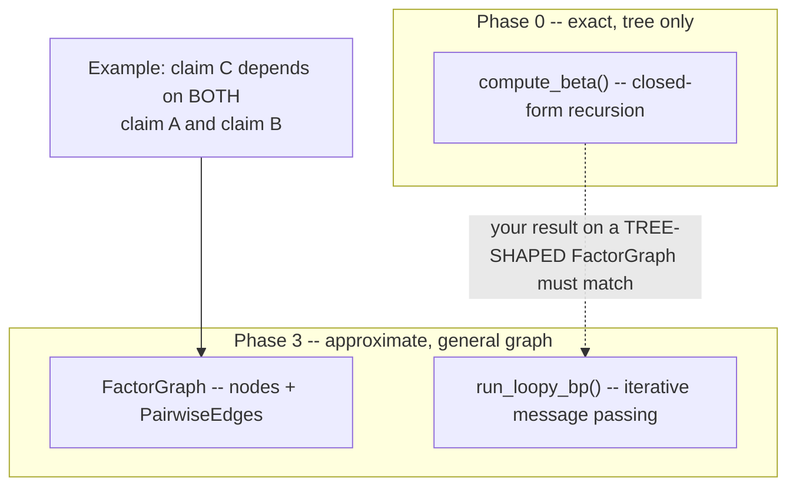
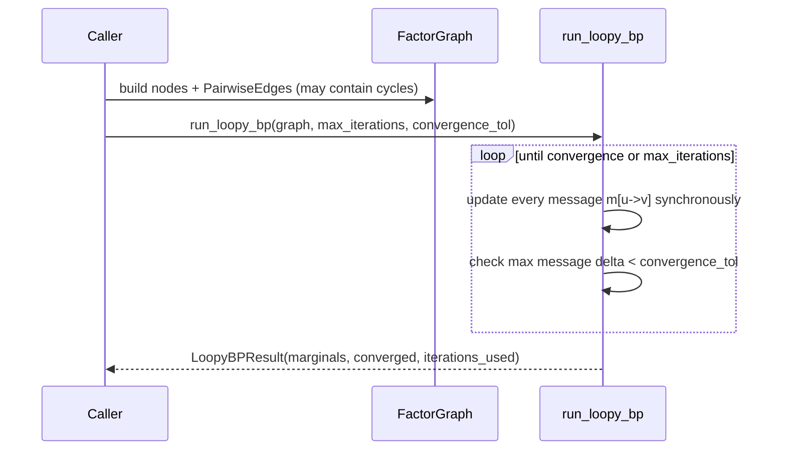

# Phase 3 — Generalise to a DAG + Loopy Belief Propagation

## Overview

BTProp's Hidden Markov Tree can't represent a claim that logically depends on more than one
earlier claim — every node has exactly one parent, by construction. Real multi-step reasoning
routinely violates that. This phase generalises the tree to a general graph and swaps the
closed-form upward-downward recursion (Phase 0) for iterative loopy belief propagation. **This is
Our Novelty, Extension 1** — one of the two concrete things this project adds on top of the base
paper.

## Concepts You Need First

- **Loopy belief propagation** — the same message-passing idea from Phase 0, run on a graph that
  *does* have cycles. Unlike the tree case, there's no theorem guaranteeing it converges to the
  exact answer, or converges at all — but empirically it often works well, and characterising
  *when* it does is itself a legitimate thing to measure, not a weakness to hide.
- **Pairwise vs. joint (n-ary) factors** — Phase 0's `IndependentChildTransition` is pairwise (one
  independent rule per parent-child pair); `DecompositionTransition` is joint (one rule over an
  entire sibling set at once). This phase's scope is pairwise only — see below.

## Scope Decision — Set This Before Writing Any Code

Implement pairwise loopy BP only — matching `IndependentChildTransition`'s style.
`DecompositionTransition`'s joint, n-ary constraint does not translate into a single pairwise edge;
representing it on a general graph would need true n-ary factor nodes, out of scope here. Write
this limitation down explicitly wherever you discuss this module — a documented scope boundary is
a strength, not an admission of failure.

## Architecture





## The Math, Briefly

Every directed message updates as:

```
m[u->v](z_v) = normalize( Σ_zu  emission(u, z_u) · compat(u, v, z_u, z_v) · Π_{w≠v} m[w->u](z_u) )
```

updated **synchronously** (every message computed from last round's values, all at once) until
the largest single-message change drops below `convergence_tol`, or `max_iterations` is hit. Node
marginals are read off by combining each node's own emission with all its incoming messages.

## The Contract You're Building Against

```python
"""Loopy belief propagation over a general pairwise factor graph (a DAG or any graph with
cycles). This is Our Novelty, Extension 1: generalising Phase 0's exact, tree-only recursion to
graphs where a node may have more than one parent.
"""

from __future__ import annotations

from dataclasses import dataclass

from src.inference.hmt import EmissionModel


@dataclass(frozen=True)
class GraphNode:
    """One claim in the graph. Unlike TreeNode, carries no explicit children/parents --
    structure lives entirely in the edge list so a node can appear as a child in more than one
    edge (i.e. have more than one parent)."""
    node_id: str
    score: float


@dataclass(frozen=True)
class PairwiseEdge:
    """A directed parent -> child relationship with its own independent compatibility function,
    same shape as IndependentChildTransition (Phase 0) but attached to one specific edge instead
    of shared across a whole tree.

    TODO: implement compat(). psi(Z_parent, Z_child) = p(Z_child=child_truth | Z_parent=
    parent_truth) -- almost identical logic to IndependentChildTransition's per-child term.
    """
    parent: str
    child: str
    p_child_true_given_parent_true: float
    p_child_true_given_parent_false: float

    def compat(self, parent_truth: bool, child_truth: bool) -> float:
        raise NotImplementedError


@dataclass(frozen=True)
class FactorGraph:
    """A general graph of claims -- may contain cycles once moralised (a node with two parents
    is enough to create one).

    TODO:
        - __post_init__: validate every edge references nodes that actually exist (same idea as
          HiddenMarkovTree's validation in Phase 0 -- reuse the pattern if you wrote it there).
        - neighbor_edges(node_id): return every edge touching node_id, paired with the neighbour
          ID at its OTHER end (regardless of whether node_id is that edge's parent or child --
          message passing needs to walk edges in both directions).
    """
    nodes: dict[str, GraphNode]
    edges: tuple[PairwiseEdge, ...]
    emission: EmissionModel
    prior_true: float = 0.5

    def neighbor_edges(self, node_id: str) -> list[tuple[str, PairwiseEdge]]:
        raise NotImplementedError


@dataclass
class LoopyBPResult:
    """Convergence must be reported, never assumed."""
    marginals: dict[str, float]  # node_id -> P(Z = True)
    converged: bool
    iterations_used: int
    max_message_delta_at_stop: float


def run_loopy_bp(
    graph: FactorGraph,
    *,
    max_iterations: int = 50,
    convergence_tol: float = 1e-4,
) -> LoopyBPResult:
    """Synchronous sum-product loopy belief propagation.

    TODO, outline:
    1. Initialise every directed message m[u->v](z_v) to a uniform value (e.g. 1.0 for both
       z_v=True and False) for every ordered pair of neighbours (u, v).
    2. Repeat, up to max_iterations times:
       a. Compute a NEW value for every message, all from the OLD values (synchronous -- don't
          let one update mid-round affect others in the same round; build the new dict and only
          swap it in once the whole round is computed). For message u->v: sum over z_u of
          [ emission(u, z_u) * compat(u, v, z_u, z_v) * product of every OTHER neighbour w's
          message m[w->u](z_u) ], for each z_v. Normalise each message so its two values sum to 1.
       b. Track the largest single change between old and new messages this round.
       c. If that max change is below convergence_tol, stop and record converged=True.
    3. Once stopped, compute each node's marginal by combining its own emission with all current
       incoming messages, normalised.
    4. Return a LoopyBPResult filled in honestly -- converged must reflect whether you actually
       hit the tolerance, not just whether the loop finished.

    Edge case: what should happen with max_iterations=0? Make sure converged comes out False,
    not True by accident of how you initialised the loop variable.
    """
    raise NotImplementedError


__all__ = ["FactorGraph", "GraphNode", "LoopyBPResult", "PairwiseEdge", "run_loopy_bp"]
```

## Verify Your Own Work — Two Different Kinds of Evidence

**1. On a graph that happens to be a tree, your loopy BP result MUST match Phase 0's exact result
almost to the last decimal.** Build the exact same two-child tree from Phase 0's Checkpoint 2
(root score `0.9`, children scores `0.2` and `0.6`, same transition parameters `0.9`/`0.3`) but as
a `FactorGraph` (two `PairwiseEdge`s from root, no shared children). Run `run_loopy_bp` with a
tight `convergence_tol` (e.g. `1e-10`).

> Expected: `result.marginals["root"] == 0.8209483368719038` (same as Phase 0's Checkpoint 2 —
> this graph has no actual cycle, it's a tree wearing a `FactorGraph` costume), and
> `result.converged is True`, converging in just a few iterations.

If this doesn't match, the bug is in your message-passing implementation — a tree-shaped graph has
no loop to be approximate *about*.

**2. On a graph with a genuine cycle, your result is only ever an approximation — verify it's a
*reasonable* one against an independent brute-force oracle, and confirm it's honestly not exact.**
Build a "diamond": `root -> A`, `root -> B`, `A -> C`, `B -> C` (C has two parents). Pick your own
scores and transition parameters (or: root=`0.9`, A=`0.7`, B=`0.3`, C=`0.6`, each edge's
`(p_true_given_true, p_true_given_false)` around `(0.8-0.9, 0.15-0.3)`). Write a small brute-force
function enumerating all `2^4 = 16` joint truth assignments directly (tractable only because this
test graph is tiny — that intractability at scale is *why* loopy BP exists) and computes the exact
marginal for comparison.

> Expect your loopy BP result within roughly `0.05` of the brute-force exact marginal, and **also**
> expect it to NOT match to `1e-6` — if it ever becomes exact on a graph with a real cycle, that's
> surprising enough to investigate, not something to quietly accept as a win.

**3. `max_iterations=0` should report `converged=False`, never `True`** — a cheap, important edge
case: no message-passing round can run at all, so convergence was never actually checked.

## Production Practices Applied Here

- **Never claim convergence you didn't check.** `LoopyBPResult.converged` must be a hard boolean
  derived from your *actual measured* `max_message_delta_at_stop`, never assumed true just because
  the loop finished.
- **Keep your brute-force oracle as a test fixture, not production code** — deliberately
  exponential, fine for a 4-node test graph, not fine for anything you'd run for real.
- **A synchronous update schedule is a legitimate, defensible starting choice** — write down that
  it's a choice, not the only option, so a future you (Phase 7 ablations) knows to revisit it if
  convergence turns out unreliable on real data.

## Suggested File Structure

```
src/inference/
└── loopy.py
tests/
└── test_loopy.py    # including the brute-force oracle
```

## Git Workflow Checkpoint

Branch: `phase-3/loopy-bp`. Tag `phase-3-complete` once both kinds of verification above pass.

## Definition of Done

- [ ] Loopy BP matches exact inference (Phase 0) on a tree-shaped `FactorGraph`, tight tolerance.
- [ ] On a synthetic looped graph, convergence and approximation quality measured against a
      brute-force oracle, with a documented tolerance.
- [ ] On **real** claim DAGs (once Phase 2 is producing real trees to extend), convergence rate
      and iteration counts measured and logged.

## Common Pitfalls

- **A graph with real loops is not guaranteed to converge at all** — always check `.converged`
  before trusting `.marginals`.
- **Loopy BP being a little overconfident on looped graphs is well-known, expected behaviour**
  (message double-counting around a cycle) — not automatically a bug. That's why Checkpoint 2
  above asks for "within 0.05," not exact.
- **Reusing a variable name for two different types within one function is a genuine, easy-to-hit
  mypy trap in Python** — if a confusing type error appears where a variable seems to have the
  wrong type despite looking correct, check whether the SAME name was used earlier in the function
  for something else. Renaming, not suppressing the error, is almost always the right fix.
