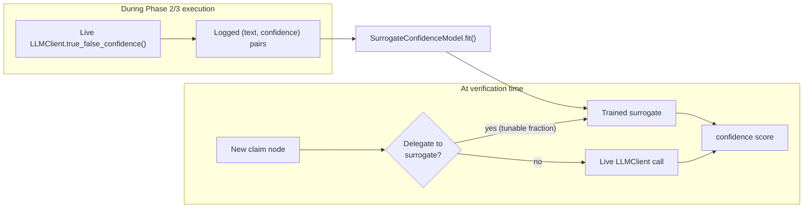

# Phase 4 — Cost Reduction via a Surrogate Confidence Scorer

## Overview

The base paper's own authors flag high time cost as their method's main limitation — many LLM
calls per tree, growing exponentially with depth — and explicitly suggest, without implementing,
selectively expanding only the most useful nodes. This phase is a concrete answer: a cheap model
that predicts an LLM's `true_false_confidence()` from claim text alone, used for a *configurable
fraction* of nodes instead of a live call. **This is Our Novelty, Extension 2.**

## Concepts You Need First

- **Text embedding** — turning text into a fixed-length numeric vector a traditional ML model can
  consume. `HashingVectorizer` (scikit-learn) maps words to vector positions via a hash function
  rather than a learned vocabulary — no downloaded weights, no training, usable immediately.
- **Ridge regression** — linear regression with an L2 penalty discouraging extreme coefficients,
  more stable on high-dimensional, sparse input (like a bag-of-words embedding) than plain linear
  regression.
- **The point of keeping this model weak on purpose** — this component's job is to be *cheap*, not
  state-of-the-art. A heavier embedding (`sentence-transformers`) is a legitimate upgrade path,
  only worth it once real numbers show the weak version isn't good enough.

## Architecture



## The Contract You're Building Against

### `embedder.py`

```python
"""Text embedding for the surrogate confidence scorer. HashingEmbedder should be a REAL,
usable embedder -- scikit-learn's hashing vectorizer needs no downloaded model weights, which is
what makes it usable with no internet access to a model hub. Deliberately weak: swap in
sentence-transformers later once real data shows a heavier embedding is worth it.
"""

from __future__ import annotations

from dataclasses import dataclass
from typing import Protocol

import numpy as np
from sklearn.feature_extraction.text import HashingVectorizer


class Embedder(Protocol):
    def embed(self, texts: list[str]) -> np.ndarray: ...


@dataclass
class HashingEmbedder:
    """TODO: implement.
        - __post_init__: construct a HashingVectorizer(n_features=self.n_features, ...) and
          store it (check scikit-learn's docs for alternate_sign and norm options -- think about
          whether you want negative feature values, and whether L2-normalising each vector makes
          sense for a downstream Ridge regressor).
        - embed(texts): use the vectorizer's .transform(texts) and convert the sparse result to a
          dense array before returning it.
    """
    n_features: int = 256

    def __post_init__(self) -> None:
        raise NotImplementedError

    def embed(self, texts: list[str]) -> np.ndarray:
        raise NotImplementedError
```

### `model.py`

```python
"""The surrogate confidence scorer -- Our Novelty, Extension 2. Approximates an LLM's own
true_false_confidence() from claim text alone, so a configurable fraction of nodes can skip a
live LLM call. Directly answers the base paper's own acknowledged limitation.
"""

from __future__ import annotations

from dataclasses import dataclass, field

import numpy as np
from sklearn.linear_model import Ridge

from src.surrogate.embedder import Embedder, HashingEmbedder


@dataclass
class SurrogateConfidenceModel:
    """Wraps an Embedder + a lightweight regressor. Keep it simple (Ridge, not a deep model) --
    this component's job is to be cheap, not state-of-the-art.

    TODO:
        - __post_init__: construct a Ridge(alpha=self.alpha) regressor and store it.
        - fit(statements, confidences): validate the two lists are the same length and there are
          at least 2 examples (raise ValueError with a clear message otherwise -- think about
          what "at least 2" protects against). Embed the statements, fit the regressor, remember
          you've been fitted.
        - predict(statement): raise a clear RuntimeError if fit() hasn't been called yet -- a
          silent garbage prediction is worse than a loud failure. Otherwise embed the statement,
          get the regressor's prediction, CLIP it to [0,1] before returning (Ridge has no
          output-range guarantee on its own).
        - predict_many(statements): the obvious loop over predict().
    """
    embedder: Embedder = field(default_factory=HashingEmbedder)
    alpha: float = 1.0

    def __post_init__(self) -> None:
        raise NotImplementedError

    def fit(self, statements: list[str], confidences: list[float]) -> None:
        raise NotImplementedError

    def predict(self, statement: str) -> float:
        raise NotImplementedError

    def predict_many(self, statements: list[str]) -> list[float]:
        raise NotImplementedError


def mean_absolute_error_against_llm(
    model: SurrogateConfidenceModel, statements: list[str], true_confidences: list[float]
) -> float:
    """The core Phase 4 evaluation number: how far off is the surrogate from the real LLM's own
    confidence, on held-out statements? Feeds directly into the accuracy-vs-delegation-fraction
    curve that is this phase's Definition of Done.

    TODO: predict on `statements`, compare against `true_confidences` with mean absolute error
    (numpy is the natural tool for this).
    """
    raise NotImplementedError
```

## Verify Your Own Work

**Proving the pipeline runs is not the same as proving it learned anything — test for the second,
harder thing.** A good synthetic dataset: statements with an absolute qualifier ("always,"
"never," "all," "none") tend to be overconfident/false; hedged statements ("usually," "most,"
"some") tend to be true:

```
"Cats always land on their feet."          -> 0.05  (false, absolute claim)
"Cats sometimes land on their feet."       -> 0.90  (true, hedged)
"All swans are white."                     -> 0.10  (false, absolute claim)
"Most swans are white."                    -> 0.90  (true, hedged)
```

Train on a handful of examples like this, then test on a **held-out** pair the model never saw —
e.g. "All politicians always tell the complete truth" vs. "Many politicians try to be honest most
of the time." Your surrogate's prediction for the first should be clearly lower than for the
second. This proves the embedding + regressor combination picks up real textual signal — not just
memorising training examples, and not just always predicting the training average.

Also test the failure modes: `predict()` before `fit()` should raise (not return garbage);
`fit()` with mismatched-length lists, or fewer than 2 examples, should raise with a clear message.

## Prerequisites

Phase 2 producing real `(claim, confidence)` pairs at some volume (a few hundred is a reasonable
start) — the synthetic test above proves your *code* works; the real evaluation needs real logged
data.

## Step by Step, Once Phase 2 Is Producing Real Data

1. **Log every real LLM confidence call** during Phase 2/3 execution — easiest done inside your
   own `CachingLLMClient` (it already sees every call) or a thin logging wrapper around it.
2. **Split logged data into train/held-out** before fitting anything.
3. **Fit and evaluate honestly** with `mean_absolute_error_against_llm` on the held-out split —
   never on training data.
4. **Build the real accuracy-vs-delegation-fraction curve** — the actual Definition of Done. For
   delegation fractions 0%, 25%, 50%, 75%, 100%: run the full pipeline with that fraction of nodes
   scored by the surrogate instead of a live call, record resulting AUROC/AUC-PR alongside the
   number of LLM calls actually saved.
5. **Decide, with the curve in hand,** whether `HashingEmbedder` is good enough or whether
   `sentence-transformers` earns its extra weight for your accuracy target.

## Production Practices Applied Here

- **Fail loudly, not quietly** — an unfitted model used for prediction, or a malformed training
  call, should raise immediately with a clear message.
- **Clip outputs to a valid range at the model boundary**, not by trusting every caller to
  remember the regressor has no such guarantee.
- **A protocol for the embedder**, exactly like `LLMClient` in Phase 1 — swapping in a heavier
  embedding later should be a config change, not a rewrite.

## Suggested File Structure

```
src/surrogate/
├── __init__.py
├── embedder.py
└── model.py
tests/
└── test_surrogate.py
```

## Git Workflow Checkpoint

Branch: `phase-4/surrogate-scorer`. Tag `phase-4-complete` once the synthetic learnability test
passes and (separately, later) once you have a real delegation-fraction curve.

## Definition of Done

- [ ] `HashingEmbedder` and `SurrogateConfidenceModel` implemented, synthetic learnability test
      passing.
- [ ] Trained on real logged data from an actual Phase 2/3 run.
- [ ] Accuracy-vs-delegation-fraction curve produced with real numbers at every point.

## Common Pitfalls

- **Don't evaluate on training data** — it will look great and tell you nothing about
  generalisation.
- **A delegation fraction isn't free just because it "saves calls"** — report the accuracy cost
  honestly at every point on the curve.
- **Watch for distribution shift** — a surrogate trained on Phase 2's statement style may not
  generalise to Phase 5's reasoning-chain statements if their vocabulary/style differs.
