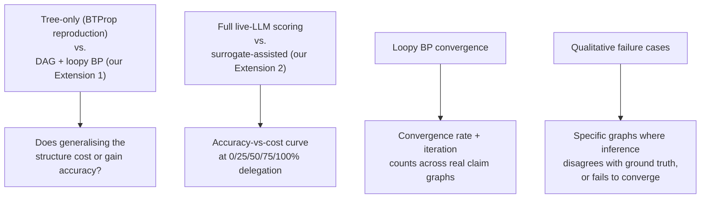

# Phase 7 — Full Evaluation

## Overview

Phases 1–5 built and validated the machinery. This phase turns it loose on real, complete
evaluation runs and produces the tables and plots the final report is actually written from.
Nothing new architecturally — this phase is about volume, rigor, and honesty in reporting, not new
code.

## What Gets Measured

## Step by Step

1. **Tree vs. DAG comparison.** Run both the tree-only pipeline (Phase 2) and the DAG+loopy-BP
   pipeline (Phase 3/5) on the same evaluation set. Report `src.eval.metrics.evaluate()`
   output for both, side by side. If the DAG version doesn't clearly beat the tree version, say so
   plainly — a null result honestly reported and explained is worth more than a cherry-picked win.
2. **Surrogate accuracy-vs-cost curve.** Finish Phase 4's own Definition of Done here if it wasn't
   already: 0/25/50/75/100% delegation fractions, each with a real AUROC/AUC-PR number and a real
   count of LLM calls saved.
3. **Convergence statistics on real data**, not just the synthetic test graphs from Phase 3: what
   fraction of real claim DAGs converge within, say, 50 iterations? What's the distribution of
   iterations-to-convergence? Plot it.
4. **Ablations.** Vary `convergence_tol` and `max_iterations` for loopy BP; vary the surrogate's
   delegation fraction — the same parameters `docs/03-roadmap.md`'s Phase 3/4 DoDs called out as
   things to measure, not assume.
5. **Failure-case analysis.** Pick 3-5 specific graphs where the system disagreed with ground
   truth, or where loopy BP didn't converge, and walk through *why* — the same qualitative-example
   discipline the base paper itself uses (docs/04-research-notes-btprop.md references this style).

## Production Practices Applied Here

- **Every plot/table is regenerable from a script, not hand-assembled.** Put plotting/table code
  in `scripts/`, not a one-off notebook cell that can't be rerun — this is what makes "wait, redo
  that with the updated data" a five-minute job instead of starting over.
- **Results get a frozen, explicitly-named snapshot at submission time** — `.gitignore` excludes
  `results/*.csv`/`*.json` generally (regenerable), but the specific numbers going into the final
  report should be committed once, explicitly, e.g. `results/final-frozen-2026-11-XX.json`, so the
  report's claims are traceable to an exact, committed artifact.
- **Statistical honesty over a good story.** A comparison run once isn't the same as a comparison
  run across multiple seeds/samples — note explicitly which numbers are single-run and which are
  averaged, rather than letting a reader assume more rigor than what was actually done.

## Definition of Done

- [ ] Tree-only vs. DAG+loopy-BP comparison table, with an honest verdict either way.
- [ ] Complete accuracy-vs-delegation-fraction curve.
- [ ] Convergence-rate statistics on real (not just synthetic) claim graphs.
- [ ] At least 3 qualitative failure cases written up with an explanation.

## Common Pitfalls

- **Don't average away the interesting failures.** A single mean AUROC hides exactly the cases
  (Phase 7's whole point) that make the failure-case analysis worth doing — keep the raw
  per-example results, not just the aggregate.
- **Re-run the Phase 0/1/3 test suite before trusting any new number.** If `uv run pytest` isn't
  green, a suspicious evaluation number is more likely a regression than a finding.
