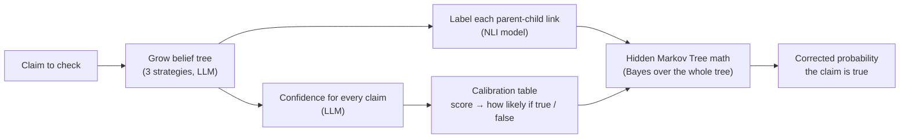

# The Big Picture

## The problem

LLMs sometimes state false things in a completely confident tone. This is called
**hallucination**. If you just ask the model "are you sure?", it is often confidently wrong
again — its own confidence score is unreliable.

## The base paper's idea (BTProp)

*"A Probabilistic Framework for LLM Hallucination Detection via Belief Tree Propagation"*
(Hou et al., NAACL 2025).

**Don't judge a claim alone. Judge it together with the claims around it.**

If the model says claim X is true, but doubts the facts X depends on, or believes facts that
contradict X, then X is probably wrong. The paper turns this intuition into probability:

1. Grow a **belief tree** around the claim: related claims as children.
2. Ask the model how confident it is about **every** claim in the tree.
3. Label how each child relates to its parent (supports it, contradicts it, means the same, …).
4. Use **Bayes' rule over the whole tree** to compute one corrected probability for the
   original claim.

## The pipeline

## The three ways to grow the tree

| Strategy | Question asked to the LLM | Children it produces |
|---|---|---|
| **Decomposition** | "Does this bundle several facts?" | The separate facts. The parent is true only if *all* of them are true. |
| **Premises** | "What facts would support this? What would contradict it?" | Supporting and contradicting facts (unrelated ones are dropped) |
| **Correction** | "What's the key question this depends on?" → answer it → rewrite the claim to match | Alternative versions of the claim |

## Worked example

A real sentence from our dataset, which human checkers marked **false**:

> "You can safely consume watermelon seeds as they are edible and even possess some beneficial
> properties…"

| Step | What happens |
|---|---|
| 1. Raw confidence | The LLM rates it **0.90** — fairly sure it's true. It's wrong. |
| 2. Grow tree | The LLM produces related claims, e.g. *"Watermelon seeds contain protein"* (support), *"Watermelon seeds pass through the gut undigested"* (contradict). *Illustrative — the exact children vary per run.* |
| 3. Label links | The NLI model labels each child: entailment, contradiction, etc. |
| 4. Score children | The LLM rates each child claim separately. |
| 5. Calibrate | Each score is turned into "how likely is a score like this if the claim is true vs. false", using a table learned from labelled data. |
| 6. Combine | The tree math combines everything into one probability. |

In our first run, a case like this went from **0.90 → 0.47** — the tree pulled a confidently
wrong answer toward the truth. (It doesn't always help; see [05-results.md](05-results.md).)

## Where our project goes beyond the paper

Two extensions, planned in `docs/phases/`:

- **Extension 1 — graph instead of tree** *(Phase 3)*. In the paper's tree, every claim has
  exactly one parent. But in multi-step reasoning a claim often depends on *several* earlier
  claims. We generalise the tree to a DAG (a graph where a node can have many parents). The
  exact tree math no longer applies there, so we switch to **loopy belief propagation** — the
  same message-passing idea, repeated until the beliefs settle.
- **Extension 2 — cheaper confidence scores** *(Phase 4)*. The paper's authors name cost as
  their main limitation: many LLM calls per tree, growing fast with depth. We train a small,
  cheap model (text features + ridge regression) to predict the LLM's confidence from the
  claim text, and use it instead of a real LLM call for a chosen fraction of nodes.

We first reproduce the paper faithfully, so that any improvement we claim later is measured
against a baseline we trust.
